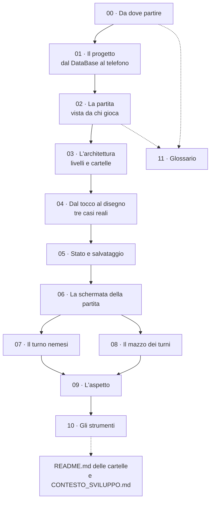

# 00 · Da dove partire

**Cosa trovi qui.** La porta d'ingresso della documentazione di `docs/`: a chi serve, in che ordine leggere i file e una mappa di
tutti i documenti. Qui si spiega anche come leggere i diagrammi.

## A chi serve

Questa documentazione è scritta per chi **conosce bene il gioco (Aeon's End) e l'app**, ma non è un programmatore, e vuole capire
da solo come funziona il codice. Ogni parola tecnica viene spiegata la prima volta che compare, con un esempio preso dall'app.
Non serve sapere programmare: serve la voglia di seguire un percorso, dal quadro generale al dettaglio.

I file di `docs/` **spiegano**; i file `README.md` dentro le cartelle di `src/` e `tools/` **elencano** (un file per riga, cosa sapere
prima di modificarlo) e sono pensati per chi scrive il codice. Qui si rimanda a loro quando serve il dettaglio.

## Come leggere un diagramma

I diagrammi di questa documentazione sono scritti in **Mermaid**: un modo di descrivere un disegno con poche righe di testo.
GitHub e l'editor di Claude li trasformano in immagini da soli. Sono di quattro tipi:

- **flowchart** (diagramma di flusso): riquadri uniti da frecce, dicono "da qui si va lì";
- **stateDiagram** (diagramma degli stati): i "posti" in cui l'app si può trovare e le frecce che dicono cosa fa passare dall'uno
  all'altro;
- **sequenceDiagram** (diagramma di sequenza): colonne con i protagonisti e frecce dall'alto in basso, nell'ordine in cui le cose
  succedono;
- **classDiagram** (diagramma delle classi): riquadri con l'elenco dei campi di un dato, per vedere di cosa è fatto.

Sopra ogni diagramma c'è una frase che dice cosa mostra, e sotto una spiegazione passo per passo. Nei diagrammi compaiono i **nomi
veri** di file, funzioni e attributi (per esempio `stato/partita.ts`, `act()`, `data-turno`), sempre accanto a cosa significano per
chi gioca.

## In che ordine leggere

Si va dal generale al particolare. Chi vuole solo il quadro può fermarsi al terzo file.

1. [01 · Il progetto](01-il-progetto.md): da dove arrivano i file, cosa sono `src/`, `public/` e `dist/`, come l'app arriva sul telefono.
2. [02 · La partita](02-la-partita.md): la partita vista da chi gioca, senza codice.
3. [03 · L'architettura](03-architettura.md): come è organizzato il codice e chi può "parlare" con chi.
4. [04 · Dal tocco al disegno](04-un-tocco.md): tre casi reali seguiti passo per passo, dal dito sullo schermo fino a quello che si vede.
5. [05 · Stato e salvataggio](05-stato-e-salvataggio.md): di quali dati è fatta una partita, come funzionano Undo e salvataggio.
6. [06 · La schermata della partita](06-schermata-partita.md): le sette zone, i momenti, le schermate e il tasto Indietro.
7. [07 · Il turno nemesi](07-turno-nemesi.md), [08 · Il mazzo dei turni](08-mazzo-dei-turni.md): i due pezzi di gioco più ricchi.
8. [09 · L'aspetto](09-aspetto.md): colori, misure, testi e lingue.
9. [10 · Gli strumenti](10-strumenti.md): i comandi per provare, controllare e confrontare.
10. [11 · Glossario](11-glossario.md): una parola del gioco, la sua parola nell'app e il suo nome nel codice. Si consulta quando serve.

## La mappa dei documenti

Il diagramma mostra come i documenti si collegano: la linea continua è l'ordine di lettura consigliato, le linee tratteggiate sono
i documenti da consultare quando serve.

Passo per passo:

1. Si parte da questo file (`A`), che spiega come leggere.
2. I file 01 e 02 (`B`, `C`) sono il quadro generale: da dove nasce l'app e come si gioca. Non servono conoscenze tecniche.
3. I file 03, 04 e 05 (`D`, `E`, `F`) entrano nel codice: come è diviso, cosa succede a ogni tocco, di quali dati è fatta la partita.
4. I file 06, 07 e 08 (`G`, `H`, `I`) sono il dettaglio delle schermate: la partita con le sue sette zone, il turno nemesi, il
   mazzo dei turni.
5. I file 09 e 10 (`J`, `K`) riguardano il "contorno": aspetto, testi, e gli strumenti per lavorare.
6. Il glossario (`L`) si apre quando una parola non è chiara, e dagli strumenti si arriva ai `README.md` delle cartelle e a
   `CONTESTO_SVILUPPO.md` per il dettaglio tecnico.

## Un'avvertenza sui nomi

Nel codice i nomi sono in **italiano e in inglese mescolati**: le parti più vecchie sono in inglese (`queue`, `resolving`,
`turnOrder`), le più nuove in italiano (`partita`, `richiediRidisegno`). Non è un errore: è la storia del progetto. Il
[glossario](11-glossario.md) mette in fila le due versioni.

## Per approfondire

- [01 · Il progetto](01-il-progetto.md) (il prossimo file)
- [11 · Glossario](11-glossario.md)
- [README.md](../README.md) in cima al repository e [CONTESTO_SVILUPPO.md](../CONTESTO_SVILUPPO.md): regole di lavoro e comandi.
- I README delle cartelle: [src/](../src/README.md), [tools/](../tools/README.md), [tests/](../tests/README.md).
