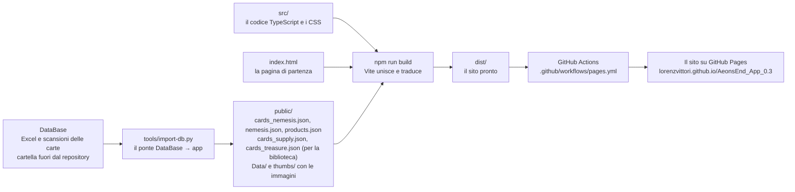
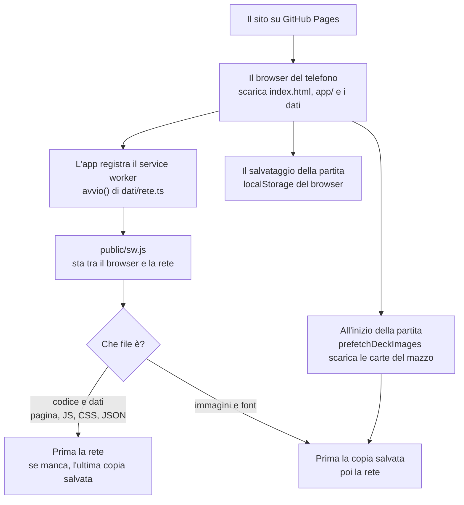

# 01 · Il progetto, dal DataBase al telefono

**Cosa trovi qui.** Il percorso completo di un file: dal DataBase delle carte fino allo schermo del telefono. Si spiega cosa sono
`src/`, `public/` e dist/, cosa fa la "build" e perché l'app funziona anche senza rete.

## L'idea in due righe

L'app è un **sito web**: non si installa da uno store, si apre in un browser (e si può mettere sulla schermata Home del telefono).
Il suo codice è scritto in **TypeScript** (un JavaScript con i tipi, cioè con l'indicazione di che "forma" ha ogni dato: un numero,
un testo, una carta...) ed è organizzato con **Vite**, lo strumento che prepara il sito. Non usa nessun "framework" (le grandi
librerie che fanno da scheletro a molte app): le schermate sono disegnate a mano dal codice.

## Il quadro generale: dalle carte al sito

Il diagramma mostra cosa succede ai dati e al codice, dalla sorgente fino al sito pubblicato. A sinistra stanno le cose che
**scrive o prepara una persona**, a destra quelle che **fabbrica un programma** da solo.

Passo per passo:

1. **DataBase.** È la raccolta personale delle carte (file Excel con una riga per carta e le scansioni). Sta in una cartella a parte,
   `DataBase`, accanto al repository: l'app la legge soltanto, non la modifica mai.
2. **`tools/import-db.py`** è uno script **Python** (un altro linguaggio di programmazione, usato qui solo per questo lavoro). Legge il
   DataBase e fabbrica i file che l'app userà: `cards_nemesis.json` (una voce per carta del mazzo nemesi), `cards_supply.json` e
   `cards_treasure.json` (le carte supply e i tesori, per la futura biblioteca: non si leggono all'avvio), `products.json` (i nomi
   dei prodotti, come "The New Age"), le immagini ridimensionate in `Data/` e le miniature in `thumbs/`. **Questi file non si modificano a mano**: se serve un
   cambiamento si rilancia lo script.
3. **`public/`** è la cartella dei file che l'app usa **così come sono**: i JSON, le immagini, il `sw.js` (il service worker, vedi sotto),
   il `manifest.webmanifest` (la "carta d'identità" dell'app installata: nome, icona, a tutto schermo).
4. **`src/`** è il codice vero e proprio: tutto quello che si scrive e si modifica. È spiegato nel [file 03](03-architettura.md).
5. **`npm run build`** è il comando che "costruisce" il sito (la build, vedi più sotto). Ha come ingressi `index.html`, `src/` e `public/`.
6. **dist/** è il risultato della build: la cartella con il sito finito. È **generata**: non si scrive a mano e non va su GitHub
   (è nel `.gitignore`).
7. **GitHub Actions** è il robot di GitHub che, quando il codice viene unito al branch `main`, esegue i controlli, costruisce il sito e lo
   pubblica. Il file che gli dice cosa fare è `.github/workflows/pages.yml`.
8. **Il sito** è su GitHub Pages: la parte di GitHub che pubblica pagine web statiche, cioè senza un computer che "pensa" dietro.

## Cosa sono `src/`, `public/` e dist/

| Cartella | Chi la scrive | Cosa contiene | Va su GitHub? |
|---|---|---|---|
| `src/` | una persona (o Claude) | codice TypeScript e CSS, diviso in cartelle per livello | sì |
| `public/` | in gran parte lo script `tools/import-db.py` | JSON, immagini, `sw.js`, `manifest.webmanifest` | sì |
| `scheletri/` | a mano | la pagina di sviluppo con le misure dell'app (seconda pagina di Vite) | sì |
| dist/ | il comando `npm run build` | il sito finito: `index.html`, la cartella dist/app/ con codice e CSS, una copia di `public/` | no |

## Cosa fa la build, e perché "unisce e traduce"

La **build** è la fabbrica che trasforma il codice scritto per le persone in un sito veloce per il browser. Fa due cose principali.

**Traduce.** Il browser non capisce TypeScript, capisce JavaScript. Vite toglie i tipi e dà al browser JavaScript puro. In più il
codice è moderno: lo si lascia moderno (i telefoni di oggi lo capiscono).

**Unisce.** In `src/` ci sono una sessantina di file `.ts`, ognuno con un compito piccolo (per esempio `regole/vite.ts` per le vite).
Caricarli uno a uno costerebbe troppe richieste di rete. La build li **impacchetta** in pochi file: un JavaScript e un CSS dentro dist/app/
(la cartella si chiama dist/app/ e non assets perché su Windows si confonderebbe con `public/Assets/`). I CSS di tutte le schermate
diventano un solo foglio, nell'ordine deciso da `stili/indice.ts` (vedi [file 09](09-aspetto.md)).

**Dà un nome con l'hash.** I file costruiti hanno un nome come `index-<hash>.js`: la parte finale (l'**hash**) cambia a ogni modifica
del contenuto. Così un telefono non può mai usare per sbaglio un codice vecchio: quando il file cambia, cambia il nome, e il browser
lo scarica di nuovo. Per questo non servono più i numeri di versione a mano che si usavano prima.

La versione mostrata nel menu iniziale (v0.3.x) non è un file da aggiornare: `vite.config.ts` la calcola da git (il tag `v0.3` e il numero di commit dopo quel tag) e la passa all'app alla partenza di `npm run dev` e `npm run build`.

Un dettaglio: il sito vive sotto l'indirizzo `/AeonsEnd_App_0.3/` e non alla radice del dominio. L'impostazione `base` in
`vite.config.ts` dice a Vite di aggiungere questo pezzo a tutti i percorsi. Per questo in locale l'app è su
`http://localhost:5173/AeonsEnd_App_0.3/`.

## La pubblicazione, con più attenzione

Il robot (`.github/workflows/pages.yml`) parte **solo con un push su `main`**, il sito pubblicato; il lavoro si fa su `sviluppo`, che non lo fa scattare (come `ts` e `main-v273`). `main` riceve `sviluppo` solo quando l'utente scrive "pubblica": `git push origin sviluppo:main`, solo fast-forward.
I suoi passi, in ordine, sono: installare i pacchetti (`npm ci`), `npm run check`, `npm test`, `npm run build`, poi
`tools/pubblicazione-precedente.mjs` e infine la pubblicazione di dist/. Se un controllo fallisce, il sito non cambia.

`tools/pubblicazione-precedente.mjs` serve per un problema pratico: GitHub Pages tiene in memoria `index.html` per circa dieci
minuti, ma i file con l'hash cambiano nome a ogni pubblicazione. Chi riceve ancora il vecchio `index.html` chiederebbe file che non
esistono più. Lo script riporta quindi in dist/app/ anche i file delle ultime pubblicazioni.

## Dal sito al telefono, e senza rete

Il secondo diagramma parte dal sito già pubblicato e arriva al telefono, mostrando come l'app resta utilizzabile quando la rete manca.

Passo per passo:

1. Il browser scarica la pagina e i file (`B`).
2. Appena l'app parte, il modulo `dati/rete.ts` registra il **service worker** (`C`). Un service worker è un piccolo programma che il
   browser tiene a parte: ogni richiesta di file dell'app passa da lui prima di andare in rete. È `public/sw.js` (`D`).
3. Per **codice e dati** (`F`) la regola è "prima la rete": se c'è, si prende la versione più nuova e se ne tiene una copia; se la rete
   manca si usa l'ultima copia. Così gli aggiornamenti arrivano subito ma l'app parte anche in aereo.
4. Per **immagini e font** (`G`) la regola è "prima la copia": non cambiano, quindi si evita di riscaricarle.
5. Quando inizi una partita, `prefetchDeckImages()` (in `dati/rete.ts`) scarica in anticipo le immagini di **tutte** le carte del mazzo
   nemesi (`I`), tre alla volta, così una carta pescata più avanti si vede anche se la rete cade. Con la modalità "Risparmio dati" del
   telefono non lo fa.
6. La **partita** non passa dalla rete: si salva nel `localStorage` del browser (`H`), una piccola memoria del browser legata al sito.
   Non esistono account né server: tutto resta sul telefono. Come funziona il salvataggio è nel [file 05](05-stato-e-salvataggio.md).

Un'avvertenza: se si sostituisce un'immagine già pubblicata **mantenendo lo stesso nome**, i telefoni tengono la vecchia. Si cambia
allora `MEDIA_CACHE` in `public/sw.js` (oggi `ae-media-v2`), che obbliga a scaricare tutto di nuovo.

## Per approfondire

- Prima: [00 · Da dove partire](00-leggimi.md). Dopo: [02 · La partita](02-la-partita.md).
- La struttura del codice: [03 · L'architettura](03-architettura.md).
- I comandi `npm run build`, `preview` e il resto: [10 · Gli strumenti](10-strumenti.md).
- Formato dei JSON e delle immagini: [src/dati/README.md](../src/dati/README.md). Lo script e la pubblicazione: [tools/README.md](../tools/README.md).
