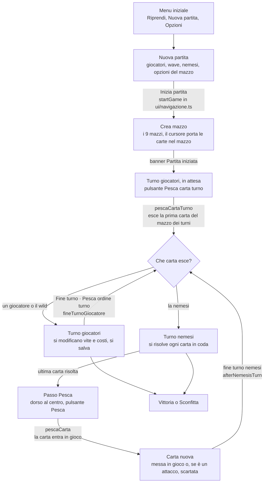
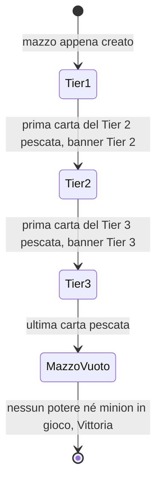
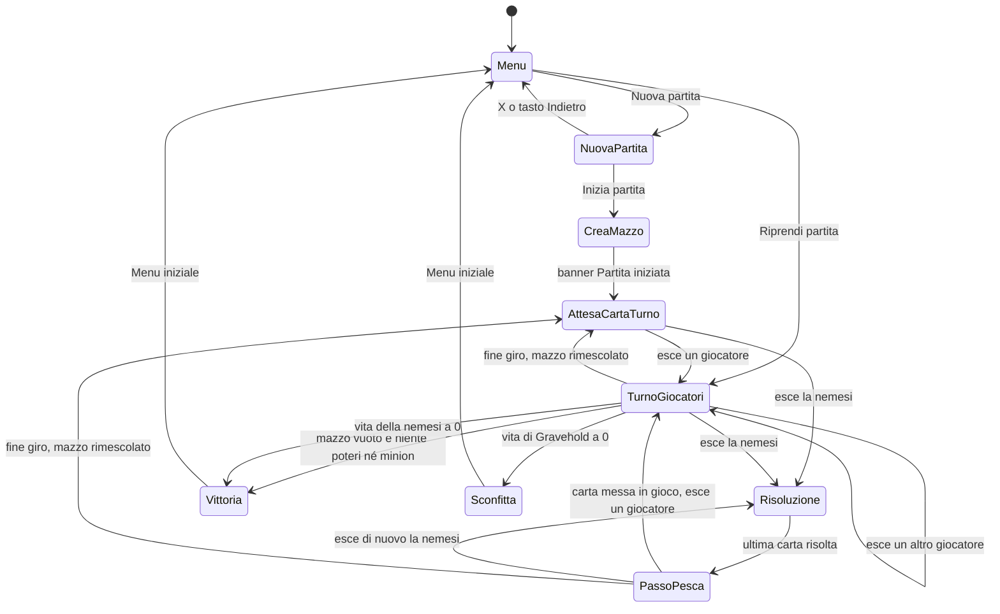

# 02 · La partita, vista da chi gioca

**Cosa trovi qui.** Come funziona una partita nell'app, dal menu alla vittoria o alla sconfitta, raccontata con le parole del gioco.
Non c'è codice: i nomi dei file e delle funzioni servono solo a dire dove si guarda, per chi vuole andare a vedere.

## I protagonisti

L'app non gioca al posto tuo: i maghi e le loro carte restano sul tavolo. L'app tiene in ordine la parte della **nemesi**:

- il **mazzo nemesi** (`deck` nel codice): le carte da pescare, con il Tier 1 in cima e il Tier 3 in fondo;
- la **coda** (`queue`): le carte nemesi già in gioco (poteri, minion), in ordine di arrivo;
- gli **scarti** (`discard`): le carte nemesi uscite;
- le **vite** di Gravehold (parte da 30) e della nemesi (dipende da quale nemesi: 45, 70, 60...);
- il **mazzo dei turni**: le carte che dicono chi gioca adesso (un giocatore, il wild, oppure la nemesi). Non c'entra con il mazzo
  nemesi: è un secondo mazzo, più piccolo.

Una partita alterna quindi **turni dei giocatori** (le persone al tavolo giocano) e **turni della nemesi** (l'app guida la
risoluzione delle carte in gioco e poi la pesca di una carta nuova). Chi decide a chi tocca è il mazzo dei turni.

## Il filo della partita

Il diagramma mostra l'intera vita di una partita come una sequenza di scelte e passaggi: dal menu fino alla fine. Le parole tra
parentesi sono le funzioni o i nomi che fanno quel lavoro nel codice.

Passo per passo:

1. **Menu iniziale.** Se c'è una partita salvata compare "Riprendi partita"; altrimenti si va a "Nuova partita". Se la collezione è
   vuota, la Nuova partita è oscurata e si deve prima inserire la collezione (i prodotti che possiedi).
2. **Nuova partita.** Si scelgono giocatori (da 1 a 4), la nemesi e le opzioni del mazzo ("Modalità battaglia", "Unisci le carte della
   collezione"). "Inizia partita" crea la partita: il mazzo nemesi viene fatto subito, estratto a caso secondo la tabella del
   *Nemesis Deck Setup* (`deck-setup.json`).
3. **Crea mazzo.** Una schermata scura mostra i nove mazzi da cui nasce il mazzo nemesi (Tier 1, 2, 3 per Base, Potenziate, Specifiche).
   Si trascina un cursore in basso e le carte volano nel mazzo in alto a sinistra, prima il Tier 3 poi il 2 poi l'1. A fine corsa compare
   il banner "Partita iniziata". Il mazzo vero era già pronto: l'animazione lo mostra soltanto.
4. **Attesa della carta turno.** Il pulsante in basso dice "Pesca carta turno": si pesca la prima carta del mazzo dei turni.
5. **Che carta esce?** Se esce un giocatore (o il wild) si gioca il turno al tavolo e nell'app si possono togliere punti vita ai
   minion e segnare i costi pagati dei poteri. Se esce la nemesi parte subito il turno nemesi.
6. **Turno giocatori.** Le modifiche sono *bozze*: non valgono finché non si tocca "Salva modifiche". "Fine turno · Pesca ordine turno"
   chiude il turno e fa uscire la carta dopo.
7. **Turno nemesi.** Le carte in coda si risolvono una alla volta, dalla più vecchia: un potere perde un token (all'ultimo token va
   negli scarti), un minion resta, un attacco va negli scarti. Il pulsante dice cosa succede.
8. **Passo Pesca.** Risolte tutte le carte, al centro appare il dorso del mazzo nemesi con il pulsante dorato "Pesca".
9. **Carta nuova.** La carta pescata si gira. Un attacco si risolve e va negli scarti; un potere o un minion si "mette in gioco" e
   resta in coda. Finito questo il turno nemesi è chiuso e dal mazzo dei turni esce la carta successiva (può essere di nuovo la
   nemesi: allora il turno nemesi ricomincia).
10. **Fine.** Vedi sotto.

## I giri del mazzo dei turni

Il mazzo dei turni si consuma carta dopo carta; quando finisce, un **giro** è completo. Le carte sono: con 2 giocatori G1 G1 G2 G2,
con 3 giocatori G1 G2 G3 e il *Wild*, con 4 giocatori G1 G2 G3 G4 (oppure, con l'opzione "Carte turno 1/2 e 3/4", due carte 1/2 e due
3/4); in ogni caso **due carte nemesi**. A fine giro:

- l'ultimo turno dice "Fine turno · Mischia mazzo" (oppure "Metti in gioco · Mischia mazzo" se l'ultimo turno è della nemesi);
- il mazzo dei turni viene rimescolato (`round` sale di uno: è il "Turno N" della testata);
- l'app torna in attesa e il pulsante dice di nuovo "Pesca la prima carta turno".

Il dettaglio (carte 1/2 e 3/4, Wild, rivelare e riordinare le carte) è nel [file 08](08-mazzo-dei-turni.md).

## I Tier

Il mazzo nemesi è diviso in tre **Tier** (livelli di difficoltà): le carte del Tier 1 sono in cima, poi il Tier 2, poi il Tier 3. Il
diagramma mostra come cambia la partita quando il mazzo si consuma.

Passo per passo:

1. Il mazzo parte "al Tier 1": si pesca dalla cima, che è il Tier 1.
2. Alla **prima** carta di Tier 2 o 3 appare una scritta ("Tier 2", "Tier 3"): lo decide `drawNewCard()` in `regole/turno-nemesi.ts`,
   confrontando il Tier della carta con `maxTierDrawn`, il Tier più alto già pescato. L'istante viene anche segnato nelle statistiche.
3. Il mazzo nemesi **non si rimescola mai**: quando è vuoto non si pesca più.
4. Con il mazzo vuoto la partita si vince quando non restano poteri né minion in coda (gli attacchi non contano: vanno negli scarti).

## Come finisce

Il diagramma seguente mostra i *momenti* dell'app e i passaggi tra l'uno e l'altro, comprese le due fini possibili.

Passo per passo (i nomi in `CamelCase` sono i momenti; nel codice la schermata attuale si chiama `schermataAttuale()` e vale `menu`,
`nuova-partita`, `crea-mazzo`, `turno-giocatori`, `turno-nemesi`, o `mazzo-turni`, vedi il [file 06](06-schermata-partita.md)):

1. **Si parte dal Menu**; da lì o si crea una partita (NuovaPartita, poi CreaMazzo) o si riprende quella salvata (che porta
   direttamente al turno in cui eri).
2. **AttesaCartaTurno** è il turno giocatori "vuoto" in cui nessuna carta turno è ancora uscita. Succede a inizio partita e a ogni
   inizio di giro.
3. **Risoluzione** e **PassoPesca** sono i due pezzi del turno nemesi (nel codice, entrambi con `resolving` vero; il passo Pesca è
   quello in cui `isDrawStep()` è vero).
4. Dal turno nemesi si torna ai giocatori (o si riparte con la nemesi, o si va a fine giro) **sempre** passando per
   `afterNemesisTurn()` in `stato/partita.ts`, che estrae la carta turno successiva (risolvere, pescare a mazzo vuoto, portare a 0 la vita
   dell'ultimo minion dalla scheda: [file 07](07-turno-nemesi.md)). L'unica eccezione è il turno nemesi che finisce subito perché coda e
   mazzo sono vuoti: lì è Vittoria.
5. **Vittoria a mazzo vuoto:** quando si è nel turno giocatori, `isVictory()` (in `regole/turno-nemesi.ts`) è vero con
   `turn > 0`, mazzo vuoto e nessun potere né minion in coda. La finestra "Vittoria" la apre `checkVictory()` in `ui/navigazione.ts` una
   sola volta per ogni stato; se tocchi fuori dalla finestra torni alla partita, e con Undo puoi tornare indietro.
6. **Vittoria con la vita:** portando la vita della nemesi a 0 (o con la voce di menu "Nemesi uccisa") si vince subito. **Sconfitta:**
   la vita di Gravehold a 0. Le vite si possono cambiare in qualunque momento della partita, quindi queste due fine possono arrivare
   anche durante il turno nemesi; nel diagramma sono disegnate una volta sola, dal turno giocatori, per non riempirlo di frecce.
7. Dalle due finestre si torna al Menu con "Menu iniziale". La partita salvata resta nel browser finché non se ne crea un'altra.

## Per approfondire

- Prima: [01 · Il progetto](01-il-progetto.md). Dopo: [03 · L'architettura](03-architettura.md).
- Le sette zone dello schermo e i momenti della partita: [06 · La schermata della partita](06-schermata-partita.md).
- Il turno nemesi nel dettaglio: [07 · Il turno nemesi](07-turno-nemesi.md). Il mazzo dei turni: [08](08-mazzo-dei-turni.md).
- Le regole di gioco scritte nel codice: [src/regole/README.md](../src/regole/README.md).
- Parole del gioco e nomi nel codice: [11 · Glossario](11-glossario.md).
