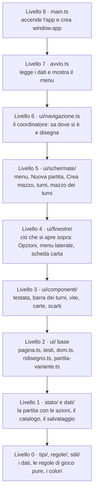
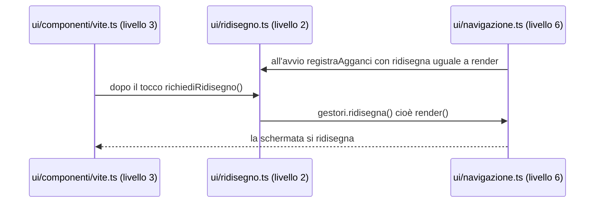
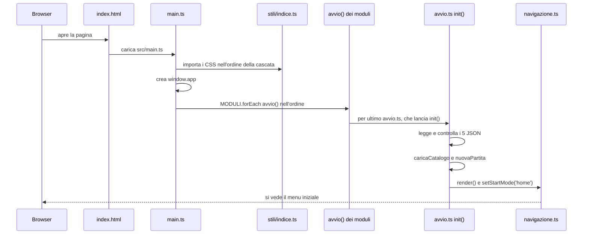

# 03 · L'architettura: livelli, cartelle e accensione

**Cosa trovi qui.** Come è organizzato il codice in `src/`: i nove livelli e la regola su chi può usare chi, la mappa delle cartelle,
cosa succede quando l'app si accende e a cosa serve `window.app`, il pannello di controllo per la console del browser.

## Qualche parola da sapere

- **Modulo.** Un file `.ts` che contiene funzioni e valori pronti da usare. Per esempio `regole/vite.ts` è il modulo con le regole
  delle vite di Gravehold e della nemesi.
- **Import.** La riga con cui un modulo dichiara "per lavorare mi serve quello che sta in quest'altro modulo". Per esempio
  `import { partita } from '../stato/partita.ts'` dice "mi serve la partita". Dall'insieme degli import si ricava chi dipende da chi.
- **Livello.** Un numero (da 0 a 8) che ogni cartella riceve in base a quanto è "in basso" o "in alto" nell'app. I livelli bassi sono i
  mattoni, quelli alti sono i pezzi che li assemblano.
- **Ciclo di import.** Il modulo A usa B e B usa A: ognuno aspetta l'altro e il codice diventa un nodo impossibile da sbrogliare.

## La regola dei livelli

**Un file importa solo da livelli più bassi del suo.** Nei livelli bassi (da 0 a 3) un file può importare anche dallo stesso livello,
purché non ci siano cicli; nei livelli 4 e 5 (finestre e schermate) ogni file può usare solo i propri file di supporto (per esempio
`ui/schermate/turno-nemesi.ts` e `ui/schermate/turno-nemesi-carosello.ts`). La regola non è una promessa: la controlla `npm run check` (lo strumento
`tools/check-moduli.mjs`) e se qualcuno la rompe il controllo fallisce.

**Perché.** Tre motivi pratici:

1. **Niente cicli.** Se le dipendenze vanno solo "verso il basso" un ciclo è impossibile per costruzione.
2. **Codice puro e provabile.** I livelli bassi non sanno niente dello schermo. `regole/` contiene le regole del gioco (come si fa un
   mazzo, cosa succede risolvendo una carta) come funzioni **pure**: dati i soli argomenti che ricevono, danno sempre lo stesso
   risultato, senza toccare la pagina, il browser, il caso o l'orologio. Per questo si provano con `npm test` in pochi secondi, senza aprire
   nessun browser.
3. **Il resto è sostituibile.** Cambiare l'aspetto di una schermata non può rompere le regole del gioco: stanno su piani diversi.

## I livelli, dal basso verso l'alto

Il diagramma mostra i nove livelli. Ogni freccia significa "può importare da": parte dal livello più alto e punta ai livelli che
ha il permesso di usare. Per non riempire il disegno sono disegnate solo le frecce dirette tra livelli vicini: una freccia in
più, per esempio da `src/main.ts` a `regole/`, sarebbe permessa ma non aggiunge niente.

Passo per passo, dal basso:

1. **Livello 0.** `tipi/` descrive la forma dei dati, `regole/` sono le regole del gioco, `stili/` sono i colori e l'ordine dei CSS. Non
   importano da niente di più alto.
2. **Livello 1.** `stato/` tiene la partita in corso (`stato/partita.ts`) e `dati/` legge i file JSON. Usano le regole del livello 0.
3. **Livello 2.** I file dentro `ui/` che non stanno in una sottocartella: gli elementi della pagina (`ui/pagina.ts`), i testi
   (`ui/testi.ts`), gli aiuti per creare elementi (`ui/dom.ts`) e gli agganci (`ui/ridisegno.ts`, vedi sotto).
4. **Livello 3.** I pezzi che servono a più schermate o che ci sono sempre: la testata, la barra dei turni, le vite, i dialoghi.
5. **Livello 4.** Le finestre che si aprono sopra una schermata, ognuna per conto suo.
6. **Livello 5.** Le schermate vere e proprie. Anche qui nessuna importa un'altra schermata.
7. **Livello 6.** `ui/navigazione.ts` è l'unico file del suo livello: il **coordinatore**. Sa quale schermata è in primo piano, è l'unico
   che mostra e nasconde i blocchi fissi della pagina e decide cosa disegnare.
8. **Livelli 7 e 8.** `avvio.ts` legge i dati e prepara la prima partita; `main.ts` mette tutto in moto.

## Come un livello basso "chiama in su": gli agganci

C'è un problema ovvio. Dopo un tocco su una vita (livello 3) l'app deve ridisegnarsi, ma chi sa ridisegnare è il coordinatore
(livello 6), che il livello 3 non può importare. La soluzione sono gli **agganci**, in `ui/ridisegno.ts` (livello 2): una lista di
funzioni con un nome chiaro (`richiediRidisegno()`, `vaiAlMenuIniziale()`, `mostraFinePartita()`...) che all'inizio sono vuote. Il
coordinatore, quando l'app si accende, le **riempie** con le funzioni vere (`registraAgganci()`). Dopo, un livello basso chiama
`richiediRidisegno()` senza sapere chi risponderà.

Passo per passo:

1. All'accensione `avvio()` di `ui/navigazione.ts` consegna a `ui/ridisegno.ts` le funzioni vere, per esempio `ridisegna: render`.
2. Più tardi un componente (qui le vite) finisce il suo lavoro e chiama `richiediRidisegno()`.
3. L'aggancio gira la chiamata alla funzione registrata, cioè a `render()`.
4. Il risultato è lo stesso di una chiamata diretta, ma gli import vanno ancora solo verso il basso.

Un'alternativa usata quando chi crea un pezzo sa già cosa deve succedere: **passare una funzione come argomento**. Per esempio
`creaBarraTurni(apri)` riceve la funzione da eseguire al tocco della barra dei turni.

## La mappa delle cartelle

| Cartella | Livello | Cosa c'è |
|---|---|---|
| `src/tipi/` | 0 | le forme dei dati: carta, partita, salvataggio |
| `src/regole/` | 0 | le regole di gioco come funzioni pure |
| `src/stili/` | 0 | palette dei colori, token, ordine di tutti i CSS |
| `src/stato/` | 1 | catalogo (i dati letti), preferenze, la partita con le azioni e l'undo, il salvataggio |
| `src/dati/` | 1 | caricamento e controllo dei JSON, collezione, rete |
| `src/ui/` (file sciolti) | 2 | elementi della pagina, testi, agganci, `variantePartita()` |
| `src/ui/componenti/` | 3 | testata, barra dei turni, vite, carte, scarti, dialoghi, sfondi |
| `src/ui/finestre/` | 4 | menu laterale, Opzioni, scheda carta, vita, statistiche, Modalità test |
| `src/ui/schermate/` | 5 | menu, Nuova partita, Crea mazzo, turno giocatori, turno nemesi, mazzo dei turni |
| `src/ui/navigazione.ts` | 6 | il coordinatore |
| `src/avvio.ts`, `src/main.ts` | 7, 8 | l'accensione |
| `public/` | fuori da `src/` | file usati così come sono: JSON, immagini, `sw.js` |
| `tests/` | fuori da `src/` | i test automatici ([file 10](10-strumenti.md)) |
| `tools/` | fuori da `src/` | strumenti per chi lavora: controlli, ponte DataBase, confronto |
| `docs/` | fuori da `src/` | questa documentazione |

I file CSS stanno **accanto al `.ts` che crea i loro elementi** (per esempio `ui/componenti/vite.ts` e `ui/componenti/vite.css`).

## L'accensione: da `index.html` alla prima schermata

Cosa succede dal momento in cui il browser apre la pagina a quello in cui si vede il menu.

Passo per passo:

1. **`index.html`** è la pagina di partenza. Contiene già i blocchi fissi (le sette zone della partita, la pagina iniziale `#start`, lo
   spazio per i dialoghi) ma vuoti; in fondo carica `src/main.ts`. Finché `main.ts` non aggiunge la classe `ready` la pagina è nascosta e
   ha il fondo scuro, per evitare un lampo bianco.
2. **`main.ts`** importa per **primo** `stili/indice.ts`, cioè tutti i CSS nell'ordine giusto (spiegato nel [file 09](09-aspetto.md)).
3. Importa anche tutti i moduli. **Al caricamento i moduli non fanno niente**: dichiarano solo funzioni e costanti. Il codice di
   accensione è dentro una funzione `avvio()` di ogni modulo che ne ha bisogno.
4. `main.ts` chiama poi le `avvio()` nell'ordine dell'elenco `MODULI`. L'ordine conta: per esempio `ui/pagina.ts` legge gli elementi
   di `index.html` e deve venire prima di chiunque li usi; `ui/testi.ts` scrive i testi nella lingua scelta; `ui/navigazione.ts`
   registra gli agganci; `avvio.ts` va per ultimo.
5. L'`avvio()` di `avvio.ts` mette il pulsante "Riprova" e lancia `init()`, che è **asincrona**: parte, aspetta la rete e intanto il
   resto continua. Legge `cards_nemesis.json`, `deck-setup.json`, `nemesis.json`, `products.json` e `Assets/nemesis/nemesis-art.json`, li controlla
   (`dati/controllo.ts`: una carta sbagliata si scarta con un messaggio in console; un file rotto ferma l'avvio e mostra l'errore),
   riempie il catalogo, prepara la prima partita da zero (`nuovaPartita()`), disegna e mostra il menu iniziale.

L'ordine in cui `main.ts` chiama le `avvio()` è questo (le righe sono raggruppate per comodità):

| Gruppo | Moduli, in ordine |
|---|---|
| base | `ui/compatibilita.ts`, `ui/testi.ts`, `ui/pagina.ts`, `dati/dati.ts`, `dati/collezione.ts` |
| pezzi e schermate | `ui/componenti/componenti.ts`, `ui/componenti/dialoghi.ts`, `ui/schermate/turno-giocatori.ts`, `ui/componenti/scarti.ts`, `ui/schermate/menu.ts`, `ui/finestre/opzioni.ts`, `ui/schermate/turno-nemesi.ts`, `ui/finestre/scheda-carta.ts`, `ui/componenti/barra-turni.ts`, `ui/componenti/testata.ts`, `ui/finestre/statistiche.ts`, `ui/schermate/crea-mazzo.ts`, `ui/componenti/pesca-undo.ts`, `ui/componenti/sfondi.ts` |
| coordinatore e rete | `ui/navigazione.ts`, `ui/finestre/menu-laterale.ts`, `dati/rete.ts`, `ui/finestre/test.ts` |
| ultimo | `avvio.ts` |

Lo stato (`stato/`) e le regole (`regole/`) **non** hanno una `avvio()`: i loro valori iniziali ci sono già al caricamento.

## `window.app`: il pannello di controllo per la console

`window.app` è l'**unica variabile globale** dell'app (cioè visibile da qualunque punto, anche dalla console del browser). Serve per
guardare e provare l'app dall'esterno: la console degli sviluppatori, la pagina di misura `scheletri/` e lo strumento di
confronto (`tools/confronto/`) la usano. Il codice dell'app non la usa mai.

Dentro ci sono tutte le funzioni esportate dai moduli e i campi dello stato, **per nome**:

| Nome in `window.app` | Cosa è |
|---|---|
| `app.render()` | ridisegna tutto |
| `app.act(...)` | la funzione che fa un'azione con undo e salvataggio ([file 04](04-un-tocco.md)) |
| `app.partita`, `app.catalogo`, `app.preferenze` | gli oggetti interi: la partita, i dati letti, le preferenze |
| `app.queue`, `app.turn`, `app.turnOrder`, `app.undoStack` | i campi della partita, uno per uno (assegnabili, ma solo per il debug) |
| `app.regole` | le regole pure, per provarle: `app.regole.turnoNemesi.isVictory(app.partita)` |
| `app.nuovaPartita()`, `app.startScenario(app.SCENARI[0])` | una partita nuova; il primo scenario della Modalità test |
| `app.noSave = true` | spegne il salvataggio nel browser |
| `app.app` | l'elemento `#app` della pagina |

Dettagli tecnici: i nomi sono collegati ai valori veri con delle "proprietà con get", quindi si legge sempre il valore di adesso, non
una copia. Se si cambia un nome si aggiornano `main.ts`, `tools/confronto/pagina-lib.js` e `scheletri/`.

## Per approfondire

- Prima: [02 · La partita](02-la-partita.md). Dopo: [04 · Dal tocco al disegno](04-un-tocco.md).
- Livelli, agganci e come si aggiunge una schermata, una finestra, un testo: [src/ui/README.md](../src/ui/README.md).
- Un README per ogni cartella: [src/](../src/README.md), [stato](../src/stato/README.md), [regole](../src/regole/README.md),
  [tipi](../src/tipi/README.md), [dati](../src/dati/README.md), [componenti](../src/ui/componenti/README.md),
  [finestre](../src/ui/finestre/README.md), [schermate](../src/ui/schermate/README.md).
- Il controllo dei livelli: [tools/README.md](../tools/README.md) e [10 · Gli strumenti](10-strumenti.md).
