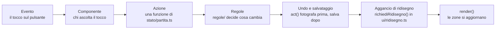
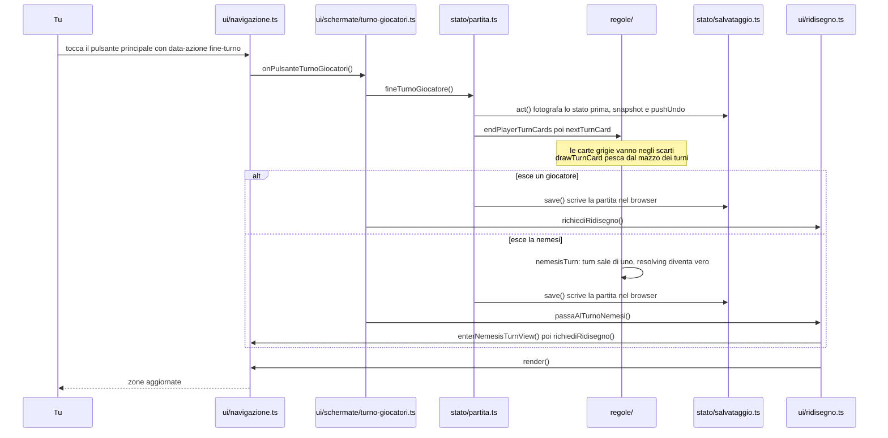
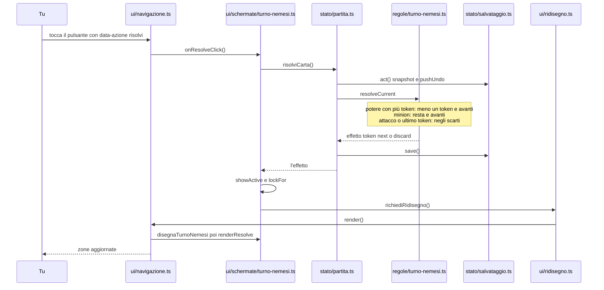
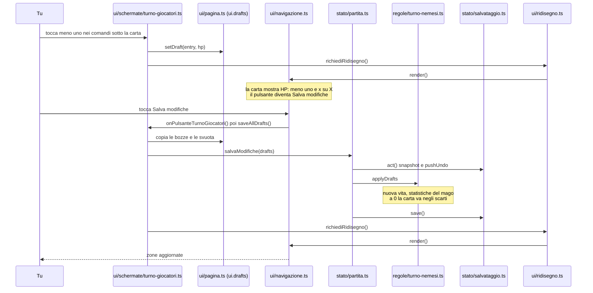

# 04 · Dal tocco al disegno

**Cosa trovi qui.** Tre casi reali seguiti passo per passo, dal dito sullo schermo fino a ciò che si vede cambiare: "Fine turno" nel
turno giocatori, risolvere una carta nel turno nemesi, togliere vita a un minion e salvare. Per ognuno i file e le funzioni
coinvolti, nell'ordine in cui lavorano.

## Il filo comune

Quasi ogni tocco che cambia la partita percorre sempre la stessa strada. Il diagramma la mostra in generale; i tre casi seguenti la
riempiono con i nomi veri.

Passo per passo:

1. **Evento.** Il browser avvisa che qualcuno ha toccato un elemento (un `click`). Un **evento** è proprio questo: "è successo
   qualcosa".
2. **Componente.** Un pezzo di interfaccia che ha chiesto di essere avvisato (con `addEventListener`) fa partire la sua funzione.
3. **Azione.** La funzione chiama un'azione di `stato/partita.ts`: è l'**unico** posto che può cambiare la partita.
4. **Regole.** L'azione non decide da sola: chiama una funzione pura di `regole/` (per esempio `resolveCurrent()`) che calcola cosa cambia.
5. **Undo e salvataggio.** Tutte le azioni passano da `act()`: prima fotografa lo stato (il passo di Undo), poi fa il cambiamento, poi
   salva la partita nel browser. **Un'azione = un passo di Undo.**
6. **Ridisegno.** Il **ridisegno** (il *render*, cioè la ricostruzione di ciò che si vede) lo chiede chi ha ricevuto il tocco, **dopo**
   l'azione, perché prima prepara le sue animazioni. Lo chiede tramite l'aggancio `richiediRidisegno()`.
7. **Zone.** `render()` in `ui/navigazione.ts` riscrive le zone dello schermo in base allo stato nuovo.

> **Render** significa "disegnare di nuovo": l'app non cambia un pezzettino alla volta, ricostruisce le zone interessate a partire
> dallo stato. Per questo lo **stato** (i dati della partita: quali carte, quante vite...) è sempre la verità e lo schermo ne è lo specchio.

## Caso (a) · "Fine turno" nel turno giocatori

Il giocatore ha finito il suo turno e tocca il pulsante in basso, che dice "Fine turno · Pesca ordine turno". Il diagramma segue il
tocco fino alla fine, con i due esiti possibili: esce una carta di un giocatore, oppure esce la nemesi.

Passo per passo:

1. **Il tocco.** Il pulsante è lo stesso in tutta la partita (`#pulsante-principale`, zona 7). Cosa fa lo dice l'attributo
   `data-azione`, che il disegno precedente ha scritto da `variantePartita()`. Con `fine-turno` il listener in `ui/navigazione.ts`
   chiama `onPulsanteTurnoGiocatori()` di `ui/schermate/turno-giocatori.ts` (serve per tutti i tocchi del pulsante principale del turno giocatori).
2. **I controlli.** `onPulsanteTurnoGiocatori()` esce subito se c'è un'animazione in corso (`ui.isTransitioning`), se c'è una carta 1/2 o 3/4 con
   il giocatore ancora da scegliere (`needsPairChoice()`), o se ci sono bozze (in quel caso il pulsante sarebbe "Salva modifiche", vedi
   il caso c).
3. **L'azione.** Chiama `fineTurnoGiocatore()` di `stato/partita.ts`, che esegue `act(endPlayerTurn)`.
4. **Undo.** `act()` per prima cosa fa la fotografia dello stato (`snapshot()`, che usa `regole/salvataggio.ts`) e la mette in
   `undoStack`. Questa fotografia è ciò che il pulsante Annulla restituirà.
5. **Le regole.** `endPlayerTurn()` chiama `endPlayerTurnCards()` (in `regole/turno-nemesi.ts`: la vita attuale di ogni minion diventa
   il nuovo riferimento di inizio turno e le carte grigie, cioè poteri pagati e minion a 0, vanno negli scarti) e poi
   `nextTurnCard()`. Se il giro è finito, quest'ultima rimescola il mazzo dei turni e restituisce "niente": si andrà in attesa. Altrimenti
   `drawTurnCard()` (in `regole/mazzo-turni.ts`) toglie la carta in cima.
6. **Se esce la nemesi** si chiama `nemesisTurn()`: `turn` sale di uno e `resolving` diventa vero.
7. **Il salvataggio.** `act()` chiama `save()`, cioè `scriviPartita()`: scrive nel `localStorage` la partita e la cronologia
   dell'Undo (ma non prima del primo turno nemesi, vedi il [file 05](05-stato-e-salvataggio.md)).
8. **Il ridisegno.** Torna il controllo a `onPulsanteTurnoGiocatori()`. Se è uscito un giocatore chiede `richiediRidisegno()`; se è uscita la
   nemesi chiama `passaAlTurnoNemesi()` che, passando dall'aggancio, fa partire `enterNemesisTurnView()` (scossa dello schermo,
   sfondo che scorre a destra, la carta da risolvere in primo piano) e a sua volta chiede il ridisegno. Se invece era l'ultimo
   turno del giro parte l'animazione `playTurnShuffle()`.
9. **`render()`.** Disegna in ordine: testata, momento della partita (`variantePartita()` scrive `data-turno`), pulsante, pile, barra
   dei turni, Undo, vite e infine il turno attuale.

**Zone aggiornate** (numeri come nel [file 06](06-schermata-partita.md)):

| Zona | Dopo un turno di giocatore | Dopo la nemesi |
|---|---|---|
| 1 testata | uguale (il "Turno N" sale solo a inizio giro) | uguale; mazzo e scarti restano |
| 2 turno | si accende la casella del giocatore, l'altra si spegne | casella "Nemesi · Risolvi" |
| 3 carte piccole | la fascia resta | la fascia con la carta da risolvere in rosso |
| 5 carte grandi | la coda, `#queue` | il carosello, `#focus` |
| 6 interattivi | i comandi della carta al centro | nascosta |
| 7 principale | colore del nuovo giocatore | testo della prima carta (per esempio "Effetto risolto") |

## Caso (b) · Risolvere una carta nel turno nemesi

È il turno nemesi, la carta da risolvere è un potere con più di un token. Si tocca il pulsante: il potere perde un token e la carta
successiva diventa quella da risolvere.

Passo per passo:

1. **Il tocco.** Con `data-azione="risolvi"` (o `pesca`) il listener di `ui/navigazione.ts` chiama `onResolveClick()` di
   `ui/schermate/turno-nemesi.ts`.
2. **I controlli.** La funzione esce se non si è nel turno nemesi, se un'animazione è in corso, se la carta al centro **non** è quella da
   risolvere (in quel caso il pulsante dice "Torna alla carta da risolvere" ed è un altro `data-azione`, `torna`), o se è un minion con
   la vita "?" ancora da impostare (allora il pulsante apre la scheda della carta).
3. **L'azione.** `risolviCarta()` in `stato/partita.ts` è un `act(...)`: fotografia per l'Undo, poi `resolveCurrent()`.
4. **Le regole.** `resolveCurrent()` in `regole/turno-nemesi.ts` guarda il tipo della carta: potere con più di un token, `tokens - 1` e
   `currentIndex + 1` (effetto `token`); minion, solo `currentIndex + 1` (effetto `next`); attacco o potere all'ultimo token, la carta
   va negli scarti e finisce nelle statistiche (effetto `discard`). Se non resta niente da risolvere né da pescare, il turno nemesi finisce.
5. **Fine del turno nemesi?** Se `resolving` è tornato falso, la stessa azione chiama `afterNemesisTurn()` per estrarre la carta turno
   successiva (come nel caso a). Il tutto sta dentro lo stesso `act()`: **un tocco, un solo passo di Undo**.
6. **Il salvataggio.** `save()` scrive nel browser, qui sempre (siamo già dopo il primo turno nemesi).
7. **Le animazioni e il ridisegno.** Tornati in `onResolveClick()`: se la carta è stata scartata vola verso la pila degli scarti in alto
   (`flyToDiscard`), `showActive()` aggiorna la carta mostrata (`ui.viewedUid`) e `lockFor(ms)` blocca i tocchi (`ui.isTransitioning`)
   per la durata dell'animazione; a fine tempo `lockFor` sblocca e ridisegna di nuovo. Intanto `richiediRidisegno()` fa subito
   `render()`.
8. **Il disegno.** `render()` vede `partita.resolving` vero e chiama `disegnaTurnoNemesi()`, cioè `renderResolve()` in
   `ui/schermate/turno-nemesi-carosello.ts`: ricostruisce la fascia piccola, il carosello (solo se la sua "firma" è cambiata) e il
   pulsante principale. Se non ci sono più carte da risolvere, `variantePartita()` dà il momento `pesca` e si vede il dorso del mazzo.

**Zone aggiornate:**

| Zona | Cosa cambia |
|---|---|
| 2 turno | il testo sotto la barra ("Nemesi · Risolvi" o "Pesca") |
| 3 carte piccole | la carta risolta esce (se scartata) e il rosso passa alla prossima; un potere con token mostra un token in meno |
| 4 vite | invariate (a meno che l'effetto sul tavolo le cambi: si fa a mano) |
| 5 carte grandi | il carosello scorre sulla prossima carta, o mostra il dorso al passo Pesca |
| 7 principale | il testo della nuova carta da risolvere, oppure "Pesca" in dorato |
| testata, pile | il numero degli scarti sale se la carta è stata scartata |

## Caso (c) · Togliere vita a un minion e salvare

In questo caso è il turno giocatori e c'è un minion in coda. Sono **due momenti distinti**: prima si prepara la modifica (la
**bozza**), poi la si conferma con "Salva modifiche".

Passo per passo:

1. **Primo tocco, la bozza.** I comandi "−5 −1 +1" della zona 6 (creati da `cardControls()` in
   `ui/schermate/turno-giocatori.ts`) non toccano la partita. Chiamano `setDraft()` (in `ui/componenti/componenti.ts`), che scrive la
   modifica in `ui.drafts`, una mappa "carta → modifica" che vive in `ui/pagina.ts`. È **stato dell'interfaccia**, non della partita:
   non va nel salvataggio e non è un passo di Undo.
2. **Il ridisegno.** `richiediRidisegno()`, e `render()` mostra la bozza: l'etichetta "HP: −1" sulla carta e il box della vita con "x/X"
   (X è la vita prima del danno). `variantePartita()` vede `u.drafts.size > 0` e cambia l'azione in `salva-modifiche`: il pulsante diventa
   dorato "Salva modifiche" e compare accanto "Annulla modifiche" (che svuota le bozze, senza Undo).
3. **Secondo tocco, il salvataggio.** Il pulsante chiama ancora `onPulsanteTurnoGiocatori()`, che vede le bozze e chiama `saveAllDrafts()`.
   Questa copia le bozze, le svuota e chiama `salvaModifiche(drafts)` di `stato/partita.ts`.
4. **Undo e regole.** `salvaModifiche()` è un `act(...)`: fotografia, poi `applyDrafts()` in `regole/turno-nemesi.ts`, che scrive le
   nuove vite, aggiorna le **statistiche del mago** del giocatore di turno (danni, minion uccisi, poteri pagati) e manda negli scarti
   le carte grigie (minion a 0, poteri pagati). **Tutte le bozze di un turno diventano un solo passo di Undo.**
5. **Il salvataggio e il ridisegno.** `save()` scrive nel browser; poi `flyToDiscard()` fa volare le carte uscite verso la pila degli
   scarti e `richiediRidisegno()` ridisegna.
6. **L'Undo di una bozza.** Se invece si tocca il pulsante Annulla (`undo()` in `ui/componenti/ripristino.ts`) con bozze in sospeso, il
   primo tocco **scarta le bozze** e basta; solo il tocco successivo torna indietro di un'azione vera.

**Zone aggiornate:**

| Zona | Dopo il primo tocco (bozza) | Dopo "Salva modifiche" |
|---|---|---|
| 3 carte piccole | etichetta "HP: −1" sulla carta | il numero nuovo di vita; la carta sparisce se è a 0 |
| 5 carte grandi | stessa etichetta, box "x/X" | il box mostra solo la vita nuova |
| 6 interattivi | i comandi si aggiornano (il +1 si accende) | i comandi della carta al centro (o la nota "Ucciso" se a 0, fino al prossimo turno nemesi) |
| 7 principale | "Salva modifiche" dorato e "Annulla modifiche" | "Fine turno · Pesca ordine turno" |
| 1 testata, pile | invariate | gli scarti salgono se una carta è uscita |

## Per approfondire

- Prima: [03 · L'architettura](03-architettura.md). Dopo: [05 · Stato e salvataggio](05-stato-e-salvataggio.md).
- Le zone e i momenti: [06 · La schermata della partita](06-schermata-partita.md). Il turno nemesi: [07](07-turno-nemesi.md).
- Il giro di un'azione nel README: [src/stato/README.md](../src/stato/README.md). Gli agganci: [src/ui/README.md](../src/ui/README.md).
