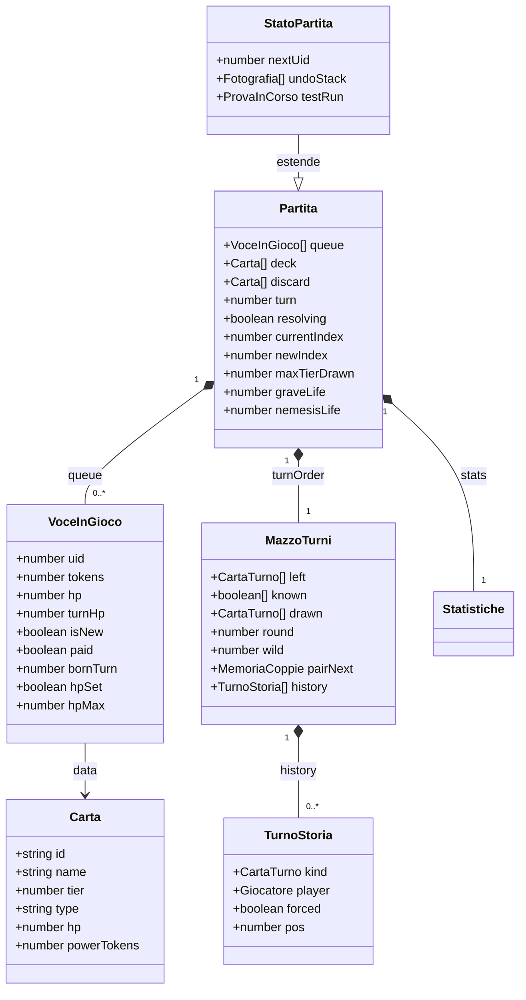
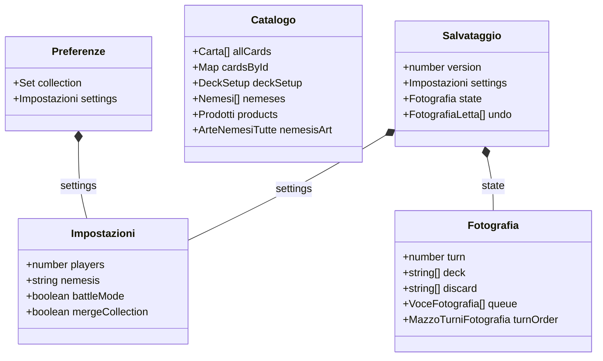
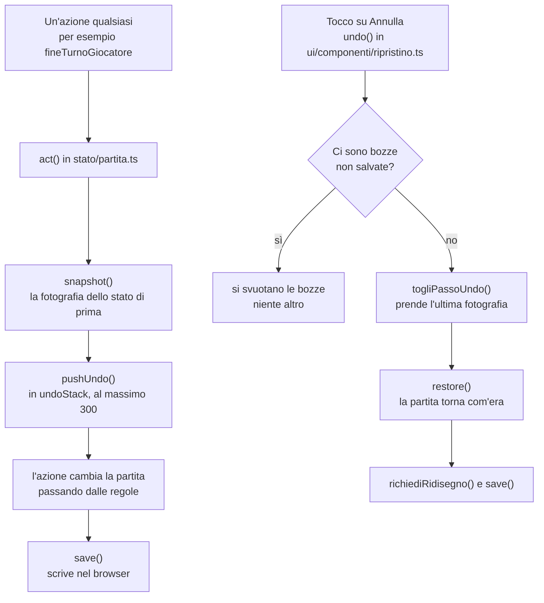
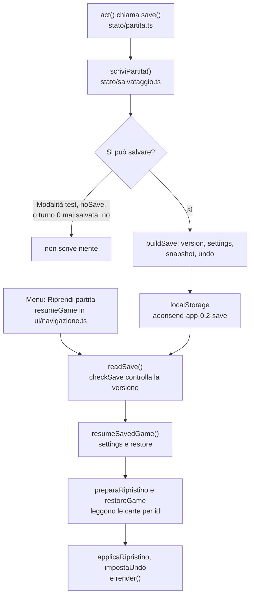

# 05 · Stato e salvataggio

**Cosa trovi qui.** Di quali dati è fatta una partita (con il significato di ogni campo), dove vivono le preferenze e i dati letti dai
file, e come funzionano l'Undo, il salvataggio e la ripresa, compresi i salvataggi delle versioni vecchie.

## Cos'è lo "stato"

Lo **stato** è l'insieme dei dati che descrivono la partita in questo istante: quali carte sono in coda, quante vite restano, a che
punto è il mazzo dei turni. Lo schermo è uno specchio dello stato: quando lo stato cambia, `render()` ridisegna.

Nell'app ci sono **tre pezzi di stato** con un compito ciascuno, tutti in `stato/`:

| Pezzo | File | Cosa tiene | Entra nel salvataggio? |
|---|---|---|---|
| la partita | `stato/partita.ts` | la partita in corso, con le azioni e l'Undo | sì |
| le preferenze | `stato/preferenze.ts` | collezione, scelte della partita, opzioni, lingua | in parte (le scelte) |
| il catalogo | `stato/catalogo.ts` | i dati letti all'avvio dai file JSON (le carte, le nemesi...) | no |

C'è poi un quarto pezzo, lo **stato dell'interfaccia** (`ui` in `ui/pagina.ts`): cose solo visive, come la carta mostrata o le
bozze. Non fa parte della partita e **non si salva né entra nell'Undo**.

Una regola che dà ordine a tutto: **solo le funzioni di `stato/partita.ts` possono cambiare la partita.** Il resto dell'app la vede
in sola lettura (`partita` è un `Readonly`, "solo lettura") e `npm run check` controlla che nessuno ne cambi un campo da fuori.

## I dati della partita

Il diagramma mostra di cosa è fatta la partita. Ogni riquadro è un tipo di dato, con i suoi campi; le linee dicono cosa contiene
cosa. I tipi veri sono in `tipi/partita.ts` e `tipi/salvataggio.ts`.

Passo per passo:

1. **`StatoPartita`** è la partita intera: tutti i campi di gioco (`Partita`) più tre cose che servono a salvare e annullare: `nextUid`,
   `undoStack` e `testRun`.
2. **`Partita`** contiene i campi di gioco: la coda, il mazzo nemesi, gli scarti, i turni, le vite, le statistiche, il mazzo dei turni.
3. **`VoceInGioco`** è una carta **in coda**: la carta di `cards.json` (`data`) più il suo stato nella partita (token rimasti, vita...).
4. **`MazzoTurni`** è il mazzo dei turni, con la sua storia del giro (`history`) e gli scarti (`drawn`).
5. **`Carta`** è una carta così come sta in `cards.json`: non cambia mai durante la partita.

### Il significato dei campi

**`StatoPartita`** (oltre ai campi di `Partita`)

| Campo | Significato |
|---|---|
| `nextUid` | il prossimo numero di identificazione da dare a una carta che entra in gioco. Non riparte mai da zero, nemmeno con una partita nuova: così una carta della partita di prima ancora sullo schermo (in animazione) non si confonde con una nuova |
| `undoStack` | le "fotografie" dello stato prima di ogni azione, dalla più vecchia. Al massimo `UNDO_LIMIT` = 300 |
| `testRun` | la Modalità test in corso (null in una partita vera): mentre c'è, niente si salva |

**`Partita`**

| Campo | Significato per chi gioca |
|---|---|
| `queue` | le carte nemesi in gioco, dalla più vecchia (la **coda**) |
| `deck` | il mazzo nemesi; si pesca dalla **fine** dell'elenco (in cima c'è il Tier 1) |
| `discard` | gli scarti nemesi |
| `turn` | i turni nemesi giocati (0 = nessuno ancora). Non è il "Turno N" della testata, che conta i giri del mazzo dei turni |
| `resolving` | vero durante il turno nemesi (risoluzione e Pesca), falso durante i turni dei giocatori |
| `currentIndex` | la posizione nella coda della carta da risolvere |
| `newIndex` | la posizione della carta appena pescata (−1 se nessuna) |
| `maxTierDrawn` | il Tier più alto pescato finora: serve ad annunciare "Tier 2" e "Tier 3" una volta sola |
| `graveLife`, `nemesisLife` | la vita di Gravehold (parte da 30) e quella della nemesi |
| `stats` | le statistiche (turni, minion uccisi, poteri, attacchi, tempi, maghi) |
| `turnOrder` | il mazzo dei turni |

**`VoceInGioco`**

| Campo | Significato |
|---|---|
| `uid` | il numero che identifica quella carta in gioco, anche se ci sono due copie della stessa carta |
| `data` | la carta di `cards.json` |
| `tokens` | i token rimasti di un potere (vuoto per le altre carte) |
| `hp` | la vita attuale di un minion (0 e `hpSet` falso = vita "?") |
| `turnHp` | la vita a inizio del turno dei giocatori: è il tetto del tasto +1 |
| `isNew` | carta appena pescata e non ancora messa in gioco (etichetta NUOVA) |
| `paid` | potere scartato pagando il costo in Æ: esce al prossimo turno nemesi |
| `bornTurn` | il turno nemesi in cui è entrata (per contare quanti turni resta in gioco un minion) |
| `hpSet`, `hpMax` | solo minion a vita variabile: vita già impostata e vita massima |

**`MazzoTurni`**

| Campo | Significato |
|---|---|
| `left` | le carte rimaste nel mazzo dei turni; `left[0]` è la cima |
| `known` | per ogni carta del mazzo, se è stata rivelata (stessa lunghezza di `left`) |
| `drawn` | gli scarti dei turni, nell'ordine in cui sono usciti |
| `round` | i giri cominciati: è il "Turno N" della testata |
| `wild` | con 3 giocatori, quale giocatore (1-3) è il Wild in questo giro |
| `picks` | chi ha giocato le carte 1/2 e 3/4 che sono negli scarti, per posizione |
| `pairNext` | la memoria delle coppie: a chi tocca la prossima carta 1/2 e la prossima 3/4 (vuoto = si sceglie) |
| `history` | un `TurnoStoria` per ogni carta pescata nel giro; l'ultimo è il turno in corso |
| `waiting` | serve solo a leggere salvataggi vecchi (turno annullato in attesa della carta turno) |

**`TurnoStoria`**: `kind` = la carta pescata; `player` = il giocatore di una carta 1/2 o 3/4 (vuoto: nemesi, altre carte, da scegliere);
`forced` = vero se il giocatore era imposto dalla memoria delle coppie; `pos` = la posizione della carta negli scarti dei turni
(vuoto se la carta è tornata nel mazzo).

## Preferenze, scelte e catalogo

Altri dati che non sono la partita ma la accompagnano. Il diagramma mostra come sono fatti e come si legano al salvataggio.

Passo per passo:

1. **`Preferenze`** (`stato/preferenze.ts`): la `collection` sono i prodotti che possiedi (codici come `"4"` o `"4.1"`); `settings`
   sono le scelte della partita (`Impostazioni`: giocatori, nemesi, "Modalità battaglia", "Unisci le carte della collezione"). Le
   scelte entrano **anche nel salvataggio**, perché per riprendere una partita serve sapere con quali giocatori e quale nemesi era.
2. Nello stesso file stanno la **lingua** e l'opzione delle carte 1/2 e 3/4: restano nel browser, in chiavi proprie di `localStorage`.
3. **`Catalogo`** (`stato/catalogo.ts`): tutto ciò che `avvio.ts` ha letto dai JSON. Si scrive una volta all'avvio e poi si legge soltanto.
   Non entra nel salvataggio: non serve, i file ci sono sempre. Per questo una `Fotografia` salva le carte **per id** (`string[]`) e non
   per intero.
4. **`Salvataggio`** è ciò che si scrive nel browser: la versione del formato, le scelte, **una** fotografia dello stato e la cronologia
   dell'Undo. **`Fotografia`** è la partita ridotta a dati semplici: invece di una carta intera c'è il suo id, e niente `uid`.

## Undo: un'azione, un passo

Il diagramma mostra cosa succede a ogni azione (a sinistra) e cosa succede quando si tocca Annulla (a destra).

Passo per passo:

1. **Prima** di cambiare qualcosa, `act()` fa la fotografia (`snapshot()`) e la mette in `undoStack`. Il cambiamento viene dopo.
2. Se le fotografie diventano più di 300, la più vecchia si butta.
3. Con **Annulla** (`undo()`), se ci sono bozze non salvate si svuotano e finisce lì (con il messaggio "Modifiche non salvate annullate").
   Altrimenti `togliPassoUndo()` prende l'ultima fotografia e `restore()` la rimette com'era: la partita va indietro **di un'azione intera**.
4. Poi si ridisegna e si salva di nuovo (lo `undoStack` accorciato finisce nel salvataggio).

**Le eccezioni dichiarate**, cioè azioni che non fanno un passo ciascuna:

- **Il mazzo dei turni.** Nella sua schermata ogni spostamento di carta si scrive subito (`applicaBozzaTurni()`, senza Undo). Un solo
  passo (`aggiungiPassoUndo()`) si aggiunge alla chiusura, con la fotografia presa all'apertura.
- **La fine della partita.** `segnaFinePartita()` scrive solo l'ora di fine (per le statistiche), senza Undo.
- **Le bozze del turno giocatori** non sono nello stato: sono in `ui.drafts`. "Salva modifiche" le trasforma in **un** passo.
- **Le vite.** Cambiare la vita nella finestra della vita o trascinando nel box è un'azione `cambiaVita()` (un passo). Tornare
  indietro dopo una Vittoria o Sconfitta rimette la vita com'era.

## Salvataggio e ripresa

La partita si salva **da sola** dopo ogni azione, nel `localStorage` del browser, alla chiave `aeonsend-app-0.2-save`. Il diagramma
mostra l'intero giro: scrittura a sinistra, ripresa a destra.

Passo per passo:

1. **Quando salva.** `scriviPartita()` non scrive nei tre casi in cui sarebbe sbagliato: durante la **Modalità test** (`testRun`), con
   `noSave` vero (la pagina di misura `scheletri/`), e **prima del primo turno nemesi** a meno che la partita sia già stata salvata
   (`gameSaved`). In particolare in "Crea mazzo" e nel primo turno dei giocatori non si scrive niente: resta l'eventuale partita di prima.
   Se il browser rifiuta (memoria piena, navigazione privata) l'app avvisa solo in console e continua.
2. **Cosa scrive.** `buildSave()` mette insieme `{ version, settings, state, undo }`: `state` è `snapshot()`, `undo` è tutto `undoStack`.
3. **Riprendi.** Dal menu `resumeGame()` legge il salvataggio con `readSave()`. `checkSave()` guarda la versione: se è diversa da
   `SAVE_VERSION` (oggi 2) il salvataggio viene **cancellato** senza errori. Se la nemesi della partita non è più nella collezione, una
   finestra lo dice e "Continua" rimette nella collezione il suo prodotto.
4. **La ripresa.** `resumeSavedGame()` rimette le scelte e chiama `restore()` (`ui/componenti/ripristino.ts`), che ferma le animazioni,
   chiude finestre e "Crea mazzo", e passa da `preparaRipristino()` in `stato/partita.ts`: prima **legge tutte le carte** (se ne manca
   una, errore e la partita in corso resta com'è), poi `applicaRipristino()` la sostituisce. Infine `impostaUndo()` rimette la
   cronologia, `gameSaved` diventa vero e si ridisegna.
5. Lo stesso `restore()` serve all'**Undo** e agli **scenari** della Modalità test: un solo modo di "rimettere una fotografia".

### Quando una partita ricomincia da zero

`campiDaZero()` in `stato/partita.ts` è l'**unico** punto che costruisce una partita vuota: coda e scarti vuoti, vita di Gravehold a 30,
statistiche azzerate, mazzo dei turni da cominciare. Lo usano `nuovaPartita()` (Nuova partita, Ricomincia, cambio dei giocatori in
"Crea mazzo", avvio), `applicaRipristino()` (ripresa, Undo, scenari) ed `esciDalTest()`.

## I salvataggi delle versioni vecchie

Nel tempo il formato del salvataggio è cambiato: sono stati aggiunti campi (`turnHp`, `bornTurn`, il mazzo dei turni, le statistiche...).
Per non perdere le partite vecchie, `tipi/salvataggio.ts` distingue due forme:

- il formato **scritto oggi** (`Fotografia`, `Salvataggio`), con tutti i campi;
- il formato **letto** (`FotografiaLetta`, `SalvataggioLetto`), dove i campi aggiunti più tardi sono **facoltativi**.

`restoreGame()` in `regole/salvataggio.ts` riempie ciò che manca con un valore sensato:

| Se manca... | Si usa... |
|---|---|
| `maxTierDrawn` | il Tier più alto tra le carte in coda e negli scarti |
| `graveLife`, `nemesisLife` | 30 e la vita iniziale della nemesi |
| `stats` | statistiche da zero (mazzo iniziale = tutte le carte) |
| `turnHp` | uguale a `hp` |
| `bornTurn` | il turno nemesi della fotografia |
| `hpMax` (minion a vita variabile già impostata) | la più alta tra vita e vita di inizio turno |
| il mazzo dei turni (`turnOrder`) | un giro nuovo con il turno in corso già pescato (`restoreTurnOrder()` in `regole/mazzo-turni.ts`) |
| `history`, `known`, `pairNext` del mazzo dei turni | ricostruiti dagli scarti e dalle scelte |

Il campo `version` serve a una decisione diversa: un salvataggio di **un'altra versione** del formato (per esempio quelli con gli id
delle carte di prima del DataBase) non si prova nemmeno a leggere: si cancella. Si cambia `SAVE_VERSION` solo se i vecchi non si
possono più leggere. Una prova con un salvataggio vero di una versione vecchia sta in `tests/dati/salvataggio-main-v228.json`
(usato da `tests/salvataggio.test.ts`).

**Un campo nuovo della partita** va in quattro posti: la fotografia, il ripristino, il salvataggio e l'Undo (che sono lo stesso
meccanismo). Si comincia dal tipo, e il compilatore dice cos'altro seguire. Il campo nuovo è **facoltativo** nei formati letti.

## Per approfondire

- Prima: [04 · Dal tocco al disegno](04-un-tocco.md). Dopo: [06 · La schermata della partita](06-schermata-partita.md).
- Il mazzo dei turni nel dettaglio: [08 · Il mazzo dei turni](08-mazzo-dei-turni.md).
- [src/stato/README.md](../src/stato/README.md) (azioni, chiavi di `localStorage`), [src/tipi/README.md](../src/tipi/README.md) (i tipi),
  [src/regole/README.md](../src/regole/README.md) (regole di gioco), [src/dati/README.md](../src/dati/README.md) (formato dei JSON).
- I test dello stato: [tests/README.md](../tests/README.md).
