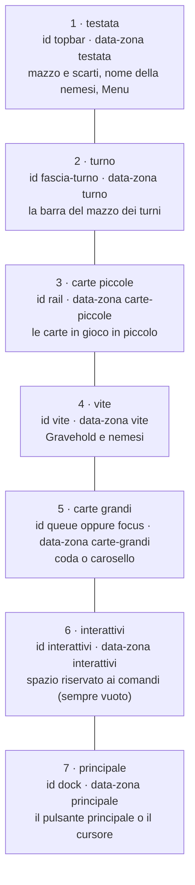
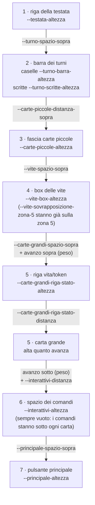
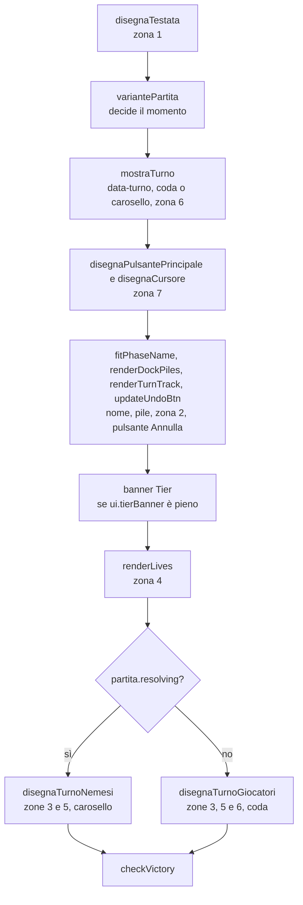
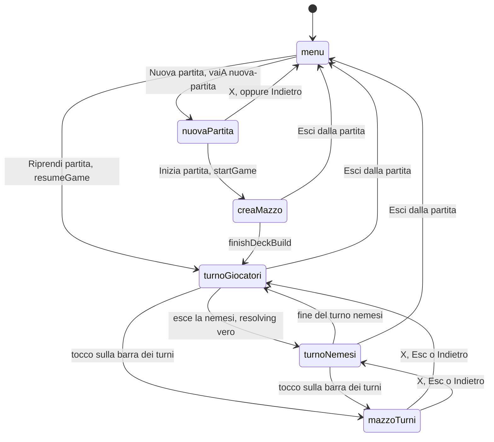
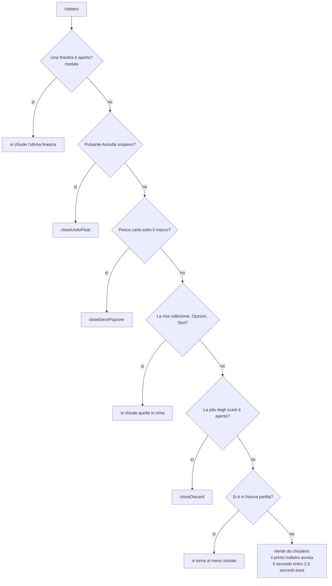

# 06 · La schermata della partita

**Cosa trovi qui.** Come è fatta la schermata in cui si gioca: le sette zone dall'alto in basso, i "momenti" della partita (giocatori,
nemesi, pesca, crea-mazzo) e cosa cambia in ciascuno, l'ordine in cui `render()` disegna, le schermate dell'app e il tasto Indietro.

## Una schermata sola, sette zone

Il turno dei giocatori, il turno nemesi, il passo Pesca e "Crea mazzo" **non sono quattro schermate**: sono una sola, `#app`, con
`data-schermata="partita"`, divisa in sette zone. Quello che cambia da un momento all'altro è cosa c'è dentro alcune zone e come si
comportano. Così la testata, le vite e il pulsante stanno sempre nello stesso posto e le carte non "saltano".

> Un **attributo `data-...`** è un'etichetta che si può attaccare a un elemento della pagina. Qui sono usati come interruttori per il
> CSS: per esempio `data-turno="nemesi"` dice "siamo nel turno nemesi", e il CSS usa quell'etichetta per cambiare lo sfondo.

Il diagramma mostra le sette zone dall'alto in basso, ciascuna con il suo `id` nella pagina (`index.html`) e il suo `data-zona`.

Passo per passo (la tabella sotto dice chi disegna ogni zona):

| Zona | Nome | Cosa mostra | Chi la disegna |
|---|---|---|---|
| 1 | testata | a sinistra il nome della nemesi, la fiamma con la battaglia, il numero di giocatori e "Turno N"; a destra mazzo, scarti e Menu | `disegnaTestata()` in `ui/componenti/testata.ts` |
| 2 | turno | la barra del mazzo dei turni: i turni del giro con i colori dei giocatori. Toccandola si apre il [mazzo dei turni](08-mazzo-dei-turni.md) | `renderTurnTrack()` in `ui/componenti/barra-turni.ts` |
| 3 | carte piccole | tutte le carte in gioco in piccolo, in una fascia che scorre. Una sola fascia, uguale nei due turni | `renderQueue()` (turno giocatori) o `renderResolve()` (turno nemesi) |
| 4 | vite | i due box: Gravehold e la nemesi. Si toccano per cambiarne la vita | `renderLives()` in `ui/componenti/vite.ts` |
| 5 | carte grandi | **la coda** `#queue` (turno giocatori) oppure **il carosello** `#focus` (turno nemesi e Pesca): uno solo è visibile | `renderQueue()` o `renderFocus()` |
| 6 | interattivi | lo **spazio riservato** ai comandi: la zona c'è sempre, alta `--interattivi-altezza`, vuota e invisibile. I comandi (−5 −1 +1, "Rimuovi · costo pagato") stanno **sotto ogni carta grande** del turno giocatori, in questo spazio, e scorrono con la carta | `cardControls()` in `ui/schermate/turno-giocatori.ts` (dentro `renderQueue()`) |
| 7 | principale | **un solo** pulsante, con accanto "Annulla modifiche" quando serve; in "Crea mazzo" al suo posto c'è il cursore | `disegnaPulsantePrincipale()` in `ui/componenti/pulsante-principale.ts` |

Come sono messe le zone e quanto sono grandi:

- **La disposizione** è in `ui/schermate/partita.css`: una griglia (`grid-template-areas`) con **una riga per zona**. Le zone da 2 a 6 stanno
  dentro `.ae-main`, che usa le righe della schermata ("sottogriglia"): così restano allineate con la testata e il pulsante.
- **Le misure** (altezze, margini, spazi) sono tutte in `ui/schermate/partita-misure.css`, come variabili con un nome parlante
  (`--turno-barra-altezza`, `--carte-piccole-altezza`...). I due turni hanno le stesse misure: una variabile sola per cosa
  (`--carte-grandi-spazio`, `--carte-piccole-altezza`, `--carte-piccole-margine`). Il codice le legge con `misura()` in `ui/componenti/misure.ts`: **nel codice non ci sono numeri di misura
  propri**.
- Dalla larghezza di 768px in su (tablet e desktop) la partita sta in una **colonna al centro**; `sizeColumn()` ne calcola la larghezza.

## Le misure tra le zone

Ogni variabile di `ui/schermate/partita-misure.css` è una **misura vera**: l'altezza di una cosa, oppure lo spazio tra due cose con un nome. Cambiarla di
N px sposta di N px esattamente quello che dice il suo commento, e niente altro (niente "centra e poi sposta", niente margini negativi di
compensazione). Il disegno è lo stesso che sta in cima a ogni zona nel file delle misure: dall'alto in basso, con la variabile tra una cosa e l'altra.

**Vederle accanto a quelle vere.** La pagina `scheletri/` (una seconda pagina di Vite, di sviluppo: non è una schermata dell'app) ha la stessa struttura del
file: un blocco per zona, nello stesso ordine, con il disegno del commento e, per ogni variabile, il nome, il commento, il valore nel file, la misura vera presa
dall'app e la differenza (in rosso se non è 0; le variabili che non si possono misurare hanno il motivo). A destra lo schermo in scala (360×720 e gli altri formati,
turno giocatori o nemesi): toccando una riga si evidenzia la cosa o lo spazio che misura. Il disegno ha tre livelli (fasce delle zone, oggetti veri misurati dal vivo, spazi tra gli oggetti come quote) e l'app vera dietro, con un cursore di trasparenza per controllare che coincidano. Si apre con `npm run dev` su <http://localhost:5173/AeonsEnd_App_0.3/scheletri/>,
con `npm run preview` su <http://localhost:4173/AeonsEnd_App_0.3/scheletri/> e, dopo la pubblicazione, nell'indirizzo del sito seguito da `scheletri/`. Misura con le stesse coppie
"tra X e Y" della prova `misure` (`tools/confronto/dati/misure.mjs`), quindi pagina e prova dicono la stessa cosa. Dettagli in [scheletri/README.md](../scheletri/README.md).

Passo per passo:

1. **Zone 5 e 6 dal basso.** La zona 6 c'è sempre, alta `--interattivi-altezza`, vuota e invisibile in tutti i momenti: è uno spazio riservato, così la
   zona 5 è alta uguale nei due turni. I comandi non sono dentro la zona 6: ogni carta grande del turno giocatori ha **i suoi** sotto di sé
   (`.queue-slot > .queue-controls`, a `--interattivi-distanza` dalla carta, larghi quanto la carta), nello spazio della zona 6; l'area delle carte
   sporge fino in fondo alla zona 6 perché non vengano tagliati. Si vedono solo per la carta al centro (`.is-centred`, messa da `markQueueRail()`),
   con una breve dissolvenza (.15s); scorrendo, ogni carta porta i suoi comandi. Dentro la zona 5, dal basso: la carta grande, poi
   `--carte-grandi-riga-stato-distanza`, poi la riga vita/token. Tra la zona 5 e la zona 6 c'è esattamente `--interattivi-distanza`.
2. **La carta grande** ha una sola regola per i due turni (`sharedCardWidth()`): altezza dell'area meno la riga vita/token e il suo spazio, oppure la
   larghezza se questa limita. Non c'è nessuna riserva per la zona 6, perché la zona 6 ha già la sua riga: carta e posizione sono uguali nei due
   turni (lo controlla la prova `misure`). La carta da pescare e quella pescata hanno il fondo sulla stessa linea e crescono verso l'alto: sono
   **la più grande che ci sta** (`sizeFocus()`), lasciando libero `--carta-pescata-spazio-sopra` sopra la loro riga vita/token (in più di
   `--carte-grandi-spazio-sopra`) e `--carta-pescata-margine-lati` ai lati (almeno quanto l'alone, che così non viene tagliato); non sborda mai
   dall'area. Non ci sono più scala né crescita.
3. **I due pesi dell'avanzo.** Quando la carta è limitata dalla larghezza, avanza altezza. Si divide tra due spaziatori (`::before` e `::after`
   dell'area delle carte, con `flex-grow`): `--carte-grandi-avanzo-sopra` (sopra la riga vita/token) e `--carte-grandi-avanzo-sotto` (tra la carta e la
   zona 6). Sono pesi, non pixel: 1 e 0 = tutto sopra (come oggi), 0 e 1 = tutto sotto, 1 e 1 = metà e metà, 3 e 1 = tre quarti sopra.
4. **Provarli dal pannello.** In Modalità test apri uno scenario e il pulsante **Regolazioni**, scheda **Misure**, gruppo "5 fascia carte grandi". Sul
   telefono la carta riempie l'altezza e non avanza niente: per vedere l'avanzo alza prima `--carte-grandi-margine-lato` (per esempio a 70px: la
   carta si stringe), poi cambia i due pesi e guarda dove va lo spazio. Sul desktop la colonna si adatta alla carta e non c'è avanzo.
5. **Le vite** stanno tra la fascia piccola e la zona 5: `--vite-spazio-sopra` sopra i box (con la scritta), e la loro parte bassa
   (`--vite-sovrapposizione-zona-5`, positiva) sta già sulla zona 5, accanto alla riga vita/token. Il carosello sporge sotto la carta di
   `--carte-grandi-alone-sotto` (sulla zona 6, vuota) solo perché l'alone della carta non venga tagliato.

## I momenti e cosa cambia in ciascuno

Il **momento** è l'attributo `data-turno` di `#app`: `giocatori`, `nemesi`, `pesca` o `crea-mazzo`. Lo decide una funzione sola,
`variantePartita()` in `ui/partita-variante.ts`. È una funzione **pura**: riceve la partita e lo stato dell'interfaccia e restituisce una
descrizione (il momento, cosa fa il pulsante, cosa fanno le carte grandi...) senza toccare niente. Per questo si prova
con i test (`tests/partita-variante.test.ts`) in tutte e due le lingue.

Il coordinatore `render()` prende quella descrizione e la applica (`mostraTurno()` in `ui/navigazione.ts`): scrive `data-turno`, mostra
la coda o il carosello (la zona 6 è sempre lo stesso spazio vuoto).

Ogni riga della tabella è una variante; la colonna "Azione" è il valore di `data-azione` sul pulsante, cioè cosa farà il tocco.

| Momento (`data-turno`) | Quando | Zona 5 | Comandi sotto le carte | Azione (`data-azione`) | Testo del pulsante (italiano) |
|---|---|---|---|---|---|
| `giocatori` | turno di un giocatore | coda | sì | `fine-turno` | "Fine turno" (poi si apre la finestra "Pesca nuovo turno") |
| `giocatori` | si aspetta la carta turno | coda | sì | `pesca-carta-turno` | "Pesca carta turno" (a inizio di un giro nuovo: "Pesca la prima carta turno"); apre la finestra "Pesca nuovo turno" |
| `giocatori` | ci sono bozze non salvate | coda | sì | `salva-modifiche` | "Salva modifiche", con "Annulla modifiche" accanto |
| `nemesi` | si risolve la carta da risolvere | carosello | no | `risolvi` | secondo la carta: "Vai avanti" (potere con più token), "Effetto risolto e scarta" (ultimo token), "Effetto risolto" (minion, attacco), "Imposta la vita" (vita "?") |
| `nemesi` | si guarda un'altra carta | carosello | no | `torna` | "Torna alla carta da risolvere" |
| `pesca` | tutte risolte, si pesca | carta coperta | no | `pesca` | "Pesca" |
| `nemesi` | la carta appena pescata | carosello | no | `risolvi` | "Metti in gioco · Fine turno nemesi" (attacco: "Effetto risolto · Fine turno") |
| `crea-mazzo` | i 9 mazzi | coda (nascosta) | sì (nascosta) | `cursore` | nessuno: al suo posto il cursore |

Dal passo **Pesca** fino alla carta pescata messa in gioco le carte piccole **non si toccano**: un tocco sulla fascia non fa niente (`viewCard()` esce subito, cursore normale, classe `is-bloccata` sulla fascia), il carosello resta sulla carta da pescare o pescata e il pulsante non cambia. Per questo al passo Pesca non esiste un'anteprima né il pulsante "Torna alla carta da pescare": `inAnteprima()` è sempre falso in quei momenti. Nel turno nemesi, prima, l'anteprima delle altre carte c'è ancora ("Torna alla carta da risolvere").

Altre cose che cambiano con il momento:

- **Lo sfondo.** È un'immagine sola, più larga dello schermo: la maga a sinistra, la nemesi a destra. Nei momenti `nemesi` e `pesca`
  si vede il lato destro; la regola sta in `ui/schermate/partita.css`, e lo sfondo scorre da un lato all'altro. Finché il turno è da
  pescare (`awaitingTurnCard()`, finestra "Pesca nuovo turno"), o una carta 1/2 o 3/4 non ha il giocatore, `mostraTurno()` scrive
  `data-fondo="centro"` e lo sfondo sta al centro; quando esce la nemesi la finestra scrive `data-fondo="destra"` (il turno nemesi si disegna
  solo alla chiusura).
- **La fascia piccola** (zona 3) senza carte resta al suo posto, vuota e invisibile (`is-vuota`): le vite non si spostano.
- **Il colore del pulsante.** Nel turno giocatori ha il colore del giocatore (`data-kind="p1"`...); nel turno nemesi l'illustrazione della
  nemesi; "Salva modifiche" e "Pesca" sono dorati.
- **Dissolvenza.** Entrando nel turno giocatori le zone compaiono in dissolvenza; dal turno nemesi no (le carte non devono sparire).

## L'ordine in cui `render()` disegna

`render()` in `ui/navigazione.ts` ridisegna tutto in base allo stato. **L'ordine conta**: per esempio il nome della nemesi si misura
solo dopo che il momento ha cambiato le classi.

Passo per passo:

1. Si disegna la testata e, subito dopo, si calcola il momento con `variantePartita()`.
2. `mostraTurno()` applica il momento: `data-turno`, quale blocco della zona 5 è visibile, se c'è la zona 6, le etichette per i lettori
   di schermo. **È l'unico punto che mostra e nasconde questi blocchi**: lo controlla `npm run check`.
3. Si disegna il pulsante principale, il cursore (che esiste solo in "Crea mazzo"), il nome della nemesi adattato alla colonna, le pile
   di mazzo e scarti, la barra dei turni e il pulsante Annulla.
4. Se `ui.tierBanner` indica un Tier nuovo, compare la scritta "Tier 2" o "Tier 3" e il valore si svuota.
5. Si disegnano le vite e poi il **turno attuale**: `partita.resolving` vero = turno nemesi, falso = turno giocatori.
6. In fondo `checkVictory()` controlla se la partita è vinta (vedi [file 02](02-la-partita.md)).

## Le schermate dell'app

"Schermata" qui ha un significato più ampio: **dove si trova l'app** adesso. `schermataAttuale()` in `ui/navigazione-stato.ts` (un
file senza pagina web dentro, quindi provabile) lo dice, scegliendo il primo caso vero: la pagina iniziale aperta (menu o Nuova partita),
poi il mazzo dei turni aperto, poi "Crea mazzo" in corso (`ui.deckBuilding`), poi il turno in corso (`partita.resolving`).

Passo per passo (i nomi in `camelCase` del diagramma corrispondono ai valori `'menu'`, `'nuova-partita'`, `'crea-mazzo'`,
`'turno-giocatori'`, `'turno-nemesi'` e `'mazzo-turni'` del tipo `Schermata`):

1. **`menu` e `nuovaPartita`** stanno nella stessa pagina iniziale (`#start`): non si accendono a vicenda, la pagina cambia solo
   contenuto. Il passaggio lo chiede chi lo vuole tramite l'aggancio `vaiA()`.
2. **`creaMazzo`** è un momento della schermata "partita": `ui.deckBuilding` è vero finché non finisce il cursore.
3. **`turnoGiocatori` e `turnoNemesi`** si alternano in base a `partita.resolving`: non esiste un "stato di navigazione" separato, la
   schermata si ricava dalla partita.
4. **`mazzoTurni`** è un foglio che scende sopra la partita; mentre è aperto, `schermataAttuale()` risponde `mazzo-turni`. Lo segna la
   schermata stessa con `impostaMazzoTurniAperto()`.
5. **Esci dalla partita** (dal menu laterale, anche in "Crea mazzo") porta al menu iniziale; con la Modalità test in corso fa anche tornare le scelte di prima.
   Da "Crea mazzo" (verificato giocando) il menu ha solo "Nuova partita", "Opzioni" e "Test": la partita appena iniziata non è salvata
   (si salva dal primo turno nemesi), quindi non c'è "Riprendi partita" e la scelta del mazzo si perde; dietro il menu `ui.deckBuilding`
   resta vero finché non parte una nuova partita.

## Il tasto Indietro

Su Android il tasto (o il gesto) Indietro normalmente esce dall'app: qui invece **chiude il livello in primo piano**. L'app aggiunge
una voce in più alla cronologia del browser (`armBackGuard()`): quando si preme Indietro, la voce in più viene "consumata" e
`closeTopForBack()` in `ui/navigazione.ts` decide cosa chiudere, rimettendo subito la voce. La decisione la prende
`cosaChiudeIndietro()` in `ui/navigazione-stato.ts`, dall'alto verso il basso:

Passo per passo:

1. L'ordine è quello dei livelli "uno sopra l'altro": ciò che si è aperto per ultimo si chiude per primo.
2. Le **finestre** sono quelle della pila di `ui/componenti/dialoghi.ts` (`openModal`): tra queste c'è anche il mazzo dei turni.
3. Se non c'è niente da chiudere, il primo Indietro mostra "Premi di nuovo Indietro per uscire"; passati 2,5 secondi la voce in più
   della cronologia viene rimessa e si ricomincia.
4. Il tasto Esc della tastiera fa un lavoro simile (chiude Annulla sospeso, "Pesca carta", la finestra in cima o gli scarti).
5. La decisione è una funzione pura con i livelli aperti come argomento, per questo si prova senza la pagina
   (`tests/navigazione.test.ts`), e c'è una prova a parte nello strumento di confronto (`indietro`).

## Per approfondire

- Prima: [05 · Stato e salvataggio](05-stato-e-salvataggio.md). Dopo: [07 · Il turno nemesi](07-turno-nemesi.md) e [08 · Il mazzo dei turni](08-mazzo-dei-turni.md).
- Colori e misure: [09 · L'aspetto](09-aspetto.md). Cosa succede a un tocco: [04](04-un-tocco.md).
- [src/ui/schermate/README.md](../src/ui/schermate/README.md) (la schermata "partita" nel dettaglio) e
  [src/ui/README.md](../src/ui/README.md) (coordinatore, agganci, Indietro).
