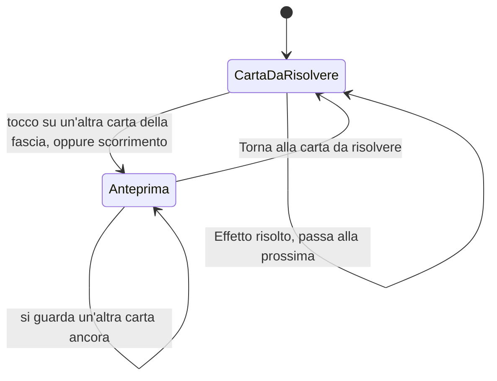
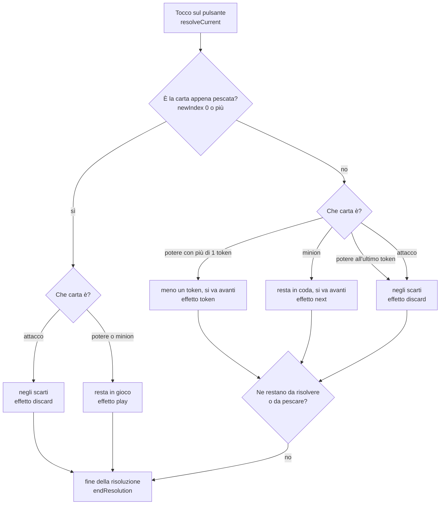
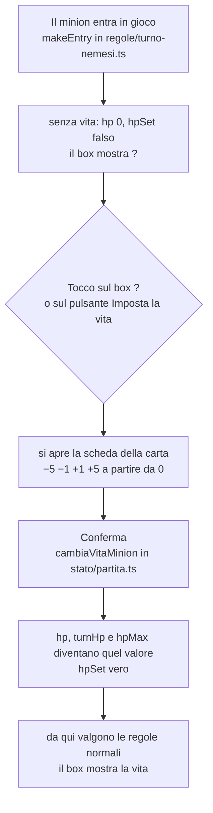
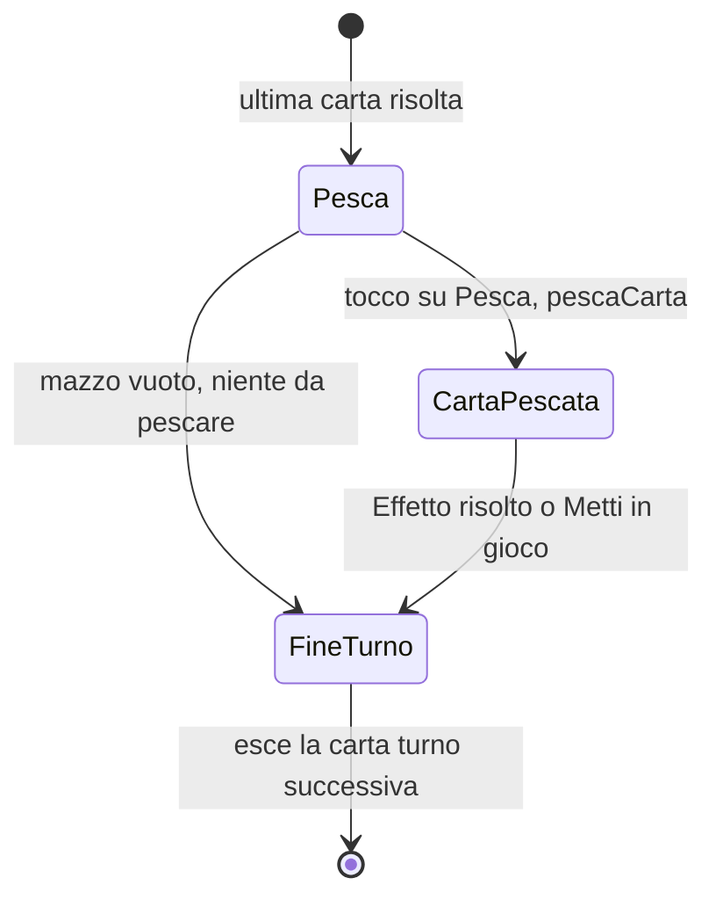

# 07 · Il turno nemesi

**Cosa trovi qui.** Il turno nemesi nel dettaglio: il carosello, la carta da risolvere, l'anteprima delle altre carte e "Torna alla
carta da risolvere", poteri e token, minion e vita "?", attacchi, la pesca, il cambio di Tier, il mazzo vuoto e la vittoria.

## Come inizia

Il turno nemesi comincia quando dal mazzo dei turni esce la carta **nemesi**. Nella partita (livello `stato/`) succedono tre cose
(`nemesisTurn()` in `regole/turno-nemesi.ts`):

1. `turn` sale di uno (i turni nemesi giocati);
2. nessuna carta è più "nuova" (`isNew` falso per tutte);
3. `resolving` diventa vero, e la carta da risolvere (`currentIndex`) è la **prima della coda**, cioè la più vecchia.

Se la coda è vuota e il mazzo ha ancora carte, si va **subito al passo Pesca**. Se la coda è vuota e il mazzo è vuoto, il turno nemesi
finisce subito: `startResolution()` chiama `endResolution()` dentro `nemesisTurn()` e **nessuna carta turno viene estratta** (la barra
resta sulla nemesi). È sempre una Vittoria a mazzo vuoto (`isVictory()`: nessun potere né minion in coda): si apre la finestra
"Vittoria" (verificato giocando). A schermo (`enterNemesisTurnView()` in `ui/schermate/turno-nemesi.ts`): una breve **scossa** dello schermo e vibrazione
(urgenza!), lo sfondo scorre verso il lato della nemesi e le carte grandi partono da quella che si stava guardando fino alla prima da
risolvere.

## Il carosello

Nel turno nemesi la zona 5 è il **carosello** (`#focus`): tutte le carte della coda in fila, che scorrono con lo "scatto" nativo del
browser (`scroll-snap`: lo scorrimento si ferma sempre con una carta al centro). Ai lati si vede un pezzo delle carte vicine.
Sopra ogni carta c'è una riga con la **vita** (minion) o i **token** (poteri); per gli attacchi la riga è vuota, così tutte le carte
restano alte uguali.

- **Il disegno** è in `renderResolve()` e `renderFocus()` (`ui/schermate/turno-nemesi-carosello.ts`). Il carosello si ricostruisce solo
  quando cambia qualcosa: lo si capisce da una "firma" (`focusStateSignature()`), una stringa con carta da risolvere, vite, token...
  Se la firma è uguale, il carosello scorre e basta.
- **La misura** (`sizeFocus()`) usa la stessa regola del turno giocatori, così una carta ha la stessa dimensione nei due turni.
- Quando il dito porta al centro un'altra carta, quella diventa la **carta mostrata** (`ui.viewedUid`).

## La carta da risolvere e le altre

Due carte sono diverse e conviene tenerle separate:

- **la carta da risolvere**: quella indicata da `currentIndex`. È l'unica su cui il pulsante principale può agire. Lampeggia di rosso
  (`.is-to-resolve`), tranne un potere con più di un token;
- **la carta mostrata**: quella al centro (`ui.viewedUid`). Di solito è la stessa, ma si può guardare un'altra carta senza risolvere
  niente: **è l'anteprima**.

Il diagramma mostra i due modi in cui si sta guardando il turno nemesi e come si passa dall'uno all'altro.

Passo per passo:

1. **CartaDaRisolvere.** La carta mostrata è quella da risolvere. Il pulsante dice cosa succede ("Vai avanti", "Effetto risolto"...).
2. **Anteprima.** Un tocco su una carta della fascia piccola (`viewCard()`) o uno scorrimento del carosello cambiano `ui.viewedUid`. Non
   cambia **niente** della partita: né mazzo, né vite, né token, né Undo.
3. `variantePartita()` (via `inAnteprima()`) vede che la carta mostrata non è quella da risolvere e cambia il pulsante: azione `torna`,
   testo "Torna alla carta da risolvere" (al passo Pesca: "Torna alla carta da pescare"), aspetto secondario.
4. **Il ritorno.** Il tocco chiama `backToActive()`, che rimette `ui.viewedUid` sulla carta giusta e il carosello scorre lì.
5. Con le frecce della tastiera sulla fascia piccola (`moveView()`) si cambia solo la carta mostrata.

## Cosa succede a ogni tipo di carta

Il pulsante principale chiama `risolviCarta()` e questa `resolveCurrent()` (`regole/turno-nemesi.ts`). Il diagramma mostra cosa
decide, carta per carta.

Passo per passo:

1. **Appena pescata?** Dopo la Pesca la carta nuova è l'unica da "chiudere". Un **attacco** va negli scarti (`discard`); un potere o un
   minion restano in gioco (`play`). In entrambi i casi la risoluzione finisce: il turno nemesi è concluso.
2. **Potere con più di un token.** Perde un token (`tokens - 1`) e la carta da risolvere diventa la successiva. Il pulsante dice "Vai avanti".
   Un dettaglio visivo: sul potere da risolvere **un token lampeggia e diventa grigio da solo** (`.is-auto-token`, anche all'ultimo
   token). È **solo visivo**: l'animazione (`ae-token-spend`) la dà il CSS all'ultimo token della riga, e finché non si tocca il pulsante
   `tokens` nella partita non cambia (verificato giocando: 2 token a schermo e nello stato, con l'animazione già attiva). Chi toglie il
   token è il tocco sul pulsante: `resolveCurrent()` fa `tokens - 1` dentro l'azione `risolviCarta()`, e il ridisegno mostra un token in meno.
3. **Potere all'ultimo token.** Va negli scarti, e viene contato nelle statistiche come "potere risolto". Il pulsante dice
   "Effetto risolto e scarta".
4. **Minion.** Resta in gioco e si passa alla successiva ("Effetto risolto"). Il minion non viene toccato dalla risoluzione: la sua vita
   si cambia a mano, dalla scheda o dai box.
5. **Attacco** (in coda): negli scarti, e conta come "attacco risolto".
6. **Finita la coda.** Quando `currentIndex` supera l'ultima carta si arriva al passo Pesca; se il mazzo è vuoto non c'è niente da pescare
   e il turno nemesi finisce qui.

## Minion e vita "?"

Alcuni minion hanno la vita **variabile**: sulla carta c'è un asterisco, perché la decidono i giocatori quando il minion entra in gioco
(nei dati: `hpVariable` vero). L'app li tratta così:

Passo per passo:

1. Un minion a vita variabile (`isVariableMinion()`) entra **senza vita**: `hp` vale 0, `hpSet` è falso, e `hpUnset()` è vero. Il box della
   vita mostra "?".
2. Finché la vita è "?", il minion **non muore a 0** e il pulsante principale, nel turno nemesi, dice "Imposta la vita" e apre la scheda
   (`openCardDialog()`): senza vita impostata non si va avanti.
3. Nella scheda ci sono quattro tasti (−5, −1, +1, +5) a partire da 0. Alla conferma `cambiaVitaMinion(entry, value, unset)` scrive la vita e,
   se è la prima impostazione e il valore è maggiore di 0, anche `turnHp` e `hpMax` (la **vita massima**: il tetto del +1).
4. La prima impostazione **non conta come danno** nelle statistiche dei maghi (`applyDrafts()`).
5. Nel turno giocatori il tocco sul box "?" apre la stessa scheda, ma la conferma scrive una *bozza*, come per le altre vite.

Per un minion normale, nel turno nemesi la scheda ha solo −1 e +1 (nel turno giocatori −5, −1 e +1). A 0 il minion esce subito:
`removeWhileResolving()` lo conta come ucciso e lo manda negli scarti, e gli indici (`currentIndex`, `newIndex`) seguono la coda.
Se era l'ultima carta del turno (la carta appena pescata, oppure l'ultima della coda senza niente da pescare) il turno nemesi finisce
**come alla fine normale**: la stessa azione (`cambiaVitaMinion()`) chiama `afterNemesisTurn()` ed estrae la carta turno, e lo
schermo fa lo stesso passaggio di `onResolveClick()` (aggancio `dopoAzioneNemesi`, che chiama `mostraDopoAzione()` in
`ui/schermate/turno-nemesi.ts`: animazione, sfondo, pulsante).

## Il passo Pesca

Risolte tutte le carte della coda si arriva al **passo Pesca** (`isDrawStep()`: `resolving` vero, nessuna carta nuova, `currentIndex`
oltre la fine della coda). Il diagramma segue il passo, fino alla carta messa in gioco e alla fine del turno.

Passo per passo:

1. **Pesca.** Al centro il dorso del mazzo (`drawSlide()`), con l'etichetta NUOVA, e il pulsante dorato "Pesca". Arriva dal mazzo in alto a
   sinistra con una piccola animazione (`animateDrawIn()`). Toccare il dorso vale come il pulsante.
2. **`pescaCarta()`** (`stato/partita.ts`) è un'azione con il suo passo di Undo: `drawNewCard()` toglie la carta in cima al mazzo (la fine
   dell'elenco), la mette **in fondo alla coda** come nuova (`isNew`, `newIndex` e `currentIndex` puntano a lei) e dice il Tier da
   annunciare.
3. **La carta pescata** si gira: finché l'immagine non è caricata si vede il dorso con "Caricamento carta..."; poi ruota in 350 ms. Ha
   l'etichetta NUOVA e un bagliore dorato; un **attacco** lampeggia di rosso. Se l'immagine non arriva si vede un segnaposto con nome e
   tipo e il tasto "Riprova immagine": il gioco può continuare.
4. **Si risolve** con il pulsante: un attacco ("Effetto risolto") vola negli scarti, un potere o un minion ("Metti in gioco · Fine turno
   nemesi") restano in coda. In entrambi i casi il turno nemesi finisce e **la stessa azione** estrae la carta turno successiva
   (`afterNemesisTurn()`): se è di nuovo la nemesi il turno riparte con una scossa.
5. **Mazzo vuoto.** Se il mazzo non ha carte non si pesca: `drawNewCard()` restituisce niente, il turno finisce e si estrae la carta
   turno successiva. **Il mazzo nemesi non si rimescola mai.**

## Come finisce il turno nemesi

Il turno nemesi finisce quando `resolving` torna falso. Le strade sono quattro; le prime tre sono dentro un'azione e la stessa azione
chiama `afterNemesisTurn()` (`stato/partita.ts`), che estrae la carta turno successiva (`nextTurnCard()`) e, se è di nuovo la nemesi,
fa ripartire il turno con `nemesisTurn()`:

| Strada | Quando | Azione | Estrae la carta turno |
|---|---|---|---|
| risolvere | ultima carta risolta senza niente da pescare, o la carta appena pescata | `risolviCarta()` (`resolveCurrent()`) | sì |
| pescare | mazzo vuoto al passo Pesca (`drawNewCard()` restituisce niente) | `pescaCarta()` | sì |
| minion a 0 dalla scheda | il minion era la carta appena pescata, o l'ultima senza niente da pescare (`removeWhileResolving()`) | `cambiaVitaMinion()` | sì |
| inizio con coda e mazzo vuoti | `startResolution()` chiude subito il turno | `fineTurnoGiocatore()` o `pescaCartaTurno()` (`nemesisTurn()`) | no: è una Vittoria |

Anche lo schermo fa lo stesso passaggio per le prime tre strade (`mostraDopoAzione()`): ritorno al turno giocatori con l'animazione, lo
sfondo e il pulsante, oppure scossa e annuncio se la nemesi riparte.

## Il cambio di Tier

Il Tier è l'etichetta di difficoltà della carta (1, 2 o 3). `drawNewCard()` confronta il Tier della carta pescata con `maxTierDrawn`,
il più alto già pescato. Alla **prima** carta di Tier 2 o 3:

- `newTier` vale 2 o 3 e `showDrawnCard()` lo scrive in `ui.tierBanner`;
- `render()` mostra la scritta "Tier 2" o "Tier 3" al centro (`showBanner()`) e azzera il valore;
- il token e la vita della carta pescata compaiono **dopo** il banner (`ui.tierWaitUntil`);
- l'istante si segna nelle statistiche (`stats.tierAt`), per i tempi di partita.

Il carattere dei titoli (Cinzel) si carica all'avvio, e il banner entra fermo e parte quando il carattere è pronto.

## Il mazzo vuoto e la vittoria

- Il mazzo nemesi non si rimescola: **quando è vuoto non si pesca più**.
- La **vittoria a mazzo vuoto** non arriva nel turno nemesi ma **dopo**, nel turno giocatori: `isVictory()` è vero quando
  `turn > 0`, il mazzo è vuoto e in coda non restano né poteri né minion. `checkVictory()` (in `ui/navigazione.ts`, chiamata a ogni
  `render()`) apre la finestra "Vittoria" una volta sola per ogni stato della partita.
- Se si tocca fuori dalla finestra si torna alla partita; con Undo si torna indietro e la condizione non vale più.
- Una vittoria diversa è portare a 0 la vita della nemesi (o "Nemesi uccisa" dal menu). La sconfitta è la vita di Gravehold a 0. Il
  quadro generale è nel [file 02](02-la-partita.md).

## Per approfondire

- Prima: [06 · La schermata della partita](06-schermata-partita.md). Dopo: [08 · Il mazzo dei turni](08-mazzo-dei-turni.md).
- Il caso (b) seguito con le funzioni: [04 · Dal tocco al disegno](04-un-tocco.md).
- Le regole scritte nel codice: [src/regole/README.md](../src/regole/README.md); le schermate: [src/ui/schermate/README.md](../src/ui/schermate/README.md).
