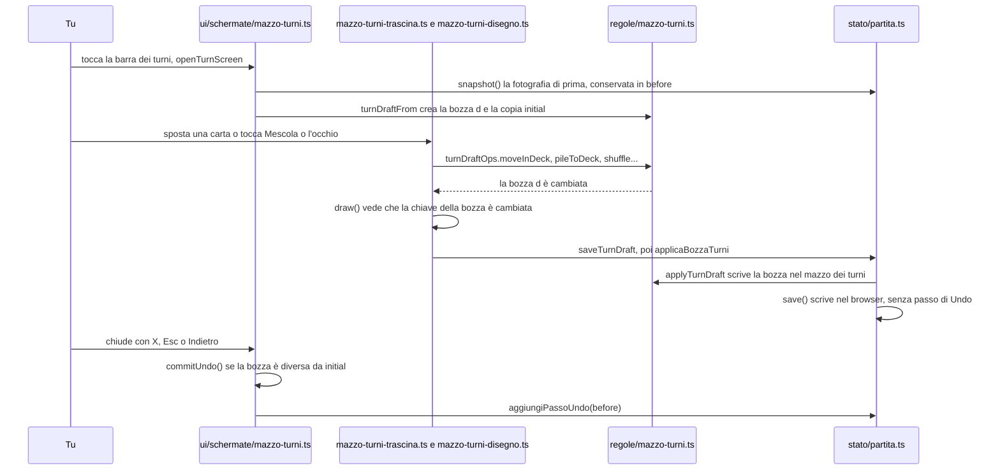
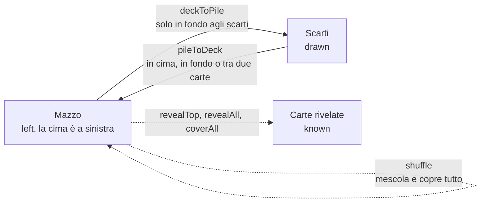
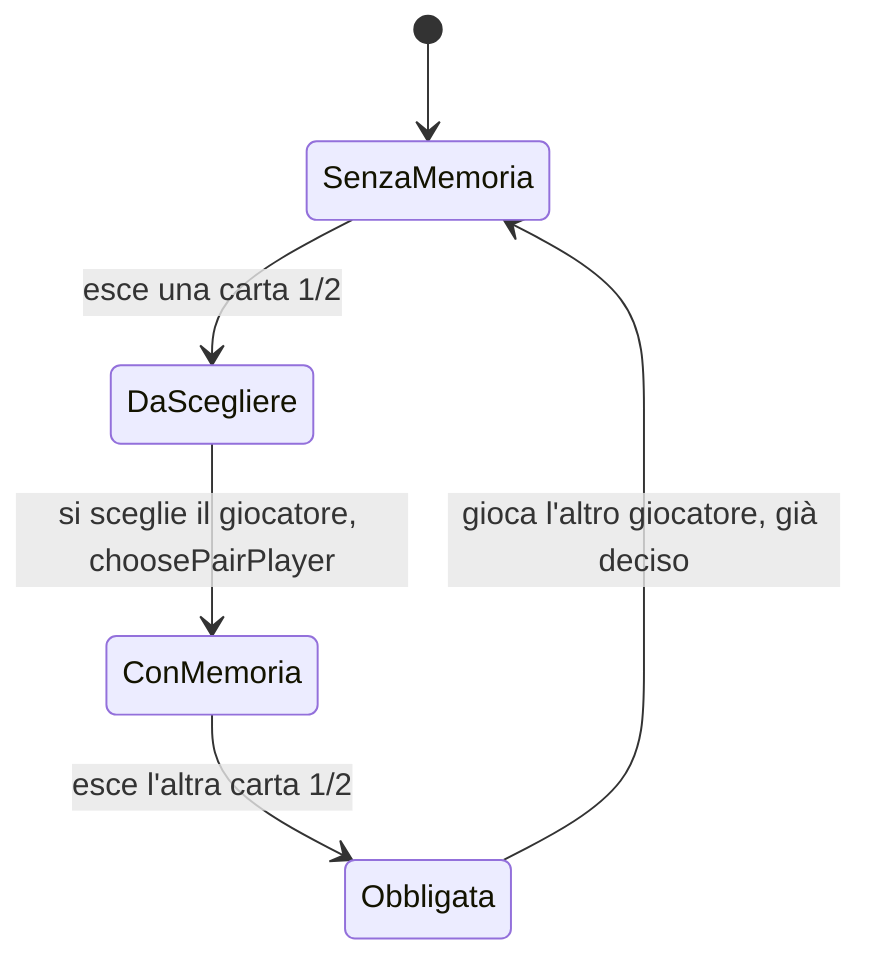
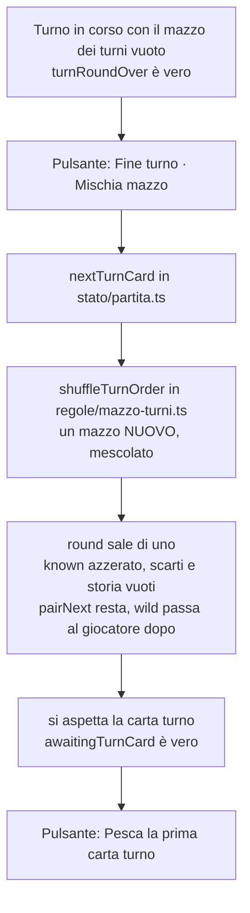

# 08 · Il mazzo dei turni

**Cosa trovi qui.** Il secondo mazzo dell'app, quello che dice chi gioca: come sono fatti il mazzo e gli scarti dei turni, come si
apre la schermata per guardarli e riordinarli, il lavoro sulla "bozza", il trascinamento, le carte rivelate, le carte 1/2 e 3/4, il
Wild, e cosa succede a fine giro.

## A cosa serve

Nel gioco da tavolo, l'ordine dei turni lo decide un mazzo di carte: ogni carta pescata dice chi gioca. L'app tiene questo mazzo (nel
codice `turnOrder`, tipo `MazzoTurni`) e lo mostra come una **barra** sotto la testata (zona 2). Il mazzo dei turni:

- **non è** il mazzo nemesi: ha poche carte (sempre 6: quattro dei giocatori o del Wild e due della nemesi), con il suo mazzo e i suoi scarti;
- ha sempre **due carte nemesi**, più le carte dei giocatori: con 2 giocatori G1 G1 G2 G2, con 3 G1 G2 G3 e il Wild, con 4 G1 G2 G3 G4
  (o due carte 1/2 e due 3/4 con l'opzione "Carte turno 1/2 e 3/4"). Lo dice `turnOrderCards()` in `regole/mazzo-turni.ts`;
- si **mescola a ogni giro** e si pesca dalla cima (`left[0]`).

La barra non mostra le carte ma i **turni** del giro: prima quelli già giocati (la `history`, con il turno in corso evidenziato), poi
le carte rimaste nel mazzo. Le carte che si conoscono (rivelate) hanno un colore più tenue (`.is-known`).

## La schermata del mazzo dei turni

Toccando la barra (zona 2) si apre un foglio che scende da sotto la barra (320 ms): è la schermata `mazzo-turni` (vedi
[file 06](06-schermata-partita.md)). Non si apre in certi momenti: durante un'animazione, in "Crea mazzo", durante la mescolata di un
giro nuovo, o se c'è un'altra finestra aperta (`turnDeckBlocked()` in `ui/schermate/mazzo-turni.ts`).

Il foglio ha un'unica riga con **gli scarti** a sinistra, un segmento verticale e **il mazzo** a destra (la cima a sinistra, come la
barra). Sopra ci sono i titoli e il tasto Mescola; sotto il mazzo l'occhio "Rivela tutto / Copri tutto"; in fondo "Ripristina tutto". In
cima c'è una copia, solo da guardare, della testata e della barra: il pulsante Menu della copia funziona.

È uno **strumento libero**: nessun vincolo per carta. Le regole delle carte del gioco che agiscono sul mazzo dei turni (per esempio
quelle che dicono "rimetti questa carta in cima") le applicano i giocatori a mano, con questi movimenti.

## La bozza, e cosa NON c'è: nessun Salva e Annulla

Il nome "bozza" qui può ingannare. Nel turno giocatori una bozza è una modifica che **non vale finché non tocchi "Salva modifiche"**.
Nella schermata del mazzo dei turni è diverso: la **bozza** è solo la copia di lavoro del mazzo (`BozzaTurni`, creata da
`turnDraftFrom()`), e **ogni modifica vale subito**. Non ci sono pulsanti Salva e Annulla: c'è "Ripristina tutto", che rimette la
bozza com'era all'apertura, e la chiusura (X, Esc, Indietro) che non chiede conferma.

Il diagramma segue una visita alla schermata, dall'apertura alla chiusura, e mostra dove entra l'Undo.

Passo per passo:

1. **Apertura.** `openTurnScreen()` fa una fotografia della partita (`before = snapshot()`) e crea due bozze identiche: `d` (quella su cui
   si lavora) e `initial` (per "Ripristina tutto" e per sapere se qualcosa è cambiato). Nella bozza si segna anche quali carte erano già
   rivelate all'apertura (`d.old`).
2. **Ogni modifica** (spostare, rivelare, mescolare) cambia solo la bozza `d`, tramite le funzioni pure di `turnDraftOps` in
   `regole/mazzo-turni.ts`. Poi `draw()` ridisegna la riga e, **se la bozza è diversa dall'ultima scritta** (confronta una stringa,
   `turnDraftKey()`), la scrive subito nella partita con `saveTurnDraft()`: `applicaBozzaTurni()` copia la bozza nel vero mazzo dei turni
   (`applyTurnDraft()`) e salva nel browser.
3. **Nessun passo di Undo a ogni mossa**: sarebbero decine. La barra dei turni dietro si aggiorna comunque (`richiediRidisegno()`).
4. **Chiusura.** `shut()` chiama `commitUndo()`: se la bozza finale è diversa da quella iniziale, aggiunge **un solo** passo di Undo, con
   la fotografia di prima (`aggiungiPassoUndo(before)`). Annulla riporta così da "dopo tutte le modifiche" a "prima di tutte". Se non
   è cambiato niente, nessun passo.

## Cosa si può fare con le carte

Il diagramma mostra dove può andare una carta e con quale operazione. Le frecce tratteggiate sono le operazioni che toccano tutto il
mazzo.

Passo per passo:

1. **Selezione e spostamento.** Un tocco su una carta la seleziona (`onCardClick()`); poi si tocca la destinazione: una carta del mazzo,
   i posti "Cima" e "Fondo" che compaiono ai lati, o gli scarti. In alternativa si **trascina**: la carta segue il dito appena si sposta
   di 6 pixel (`TURN_DRAG_PX`) e cade dove la si lascia (`onPointerMove()`, `endDrag()`). Una guida verticale mostra dove cadrà.
2. **Dal mazzo agli scarti** (`deckToPile`): la carta va **in fondo agli scarti**. Non è un turno giocato: la storia non cambia, il
   turno di quella carta è perso.
3. **Dagli scarti al mazzo** (`pileToDeck`, con `takeFromTurnPile()`): la carta torna in cima, in fondo o in una posizione scelta, resta
   rivelata e **senza giocatore**. Il turno giocato con quella carta **resta nella storia** della barra (e se era il turno in corso,
   continua). La memoria delle coppie non cambia.
4. **Carte rivelate.** Una carta del mazzo è rivelata (`known` vero) o coperta. L'occhio sulla cima rivela la prima carta, "Rivela tutto"
   le rivela tutte e poi diventa "Copri tutto". Solo le carte rivelate si possono spostare. Quelle già rivelate **all'apertura** della
   schermata (`d.old`) sono scurite e ferme, salvo quella in cima. Così si distingue ciò che si sapeva da ciò che si è scoperto adesso.
5. **Mescola.** `runShuffle()` raccoglie le carte al centro, le mischia due volte e le riapre **coperte**; con "riduci movimento" attivo
   salta l'animazione.
6. **Le carte** sono disegnate con le immagini vere in `Assets/ui/turn-cards/` (da `p1` a `p4`, `p12`, `p34`, `nemesis`, `wild`, `back`).
   Una carta 1/2, 3/4 o Wild con il giocatore già deciso mostra un tondino con il suo numero.
7. I posti vuoti (scarti o mazzo) sono un riquadro tratteggiato con il simbolo dell'insieme vuoto. I conti della riga (spazi, centratura,
   fascia dove si rilascia) sono in `ui/schermate/mazzo-turni-riga.ts`, senza pagina web, e si provano con `tests/mazzo-turni-riga.test.ts`.

## Chi gioca le carte 1/2 e 3/4

Con 4 giocatori e l'opzione "Carte turno 1/2 e 3/4" acceso (preferenza del browser, vale dal giro dopo), invece di quattro carte ce ne
sono due 1/2 (`p12`) e due 3/4 (`p34`). Quando ne esce una, **qualcuno deve dire chi gioca** tra i due. Il programma si ricorda la scelta
fatta con la **memoria delle coppie** (`pairNext`): la seconda carta della stessa coppia deve andare **all'altro** giocatore.

Passo per passo (per la coppia 1/2; la 3/4 funziona uguale e ha la sua memoria):

1. **SenzaMemoria.** `pairNext.p12` è vuoto. Esce una carta 1/2: `drawTurnCard()` non sa chi gioca.
2. **DaScegliere.** Sulla barra compare "Chi gioca questo turno?" (`renderPairChoice()` in `ui/componenti/barra-turni.ts`); finché non si
   sceglie, il pulsante principale non fa niente (`needsPairChoice()`). La scelta chiama `scegliGiocatoreCoppia()`, un'azione con il suo
   passo di Undo.
3. **ConMemoria.** `choosePairPlayer()` scrive il giocatore nella storia (e in `picks`, la lista di chi ha giocato le carte negli scarti)
   e mette in `pairNext.p12` **l'altro** giocatore.
4. **Obbligata.** Quando esce la seconda carta 1/2, `drawTurnCard()` vede la memoria piena: il giocatore è già deciso
   (`forced` vero) e la memoria torna vuota. La barra mostra già anche il giocatore **previsto** per le carte note del mazzo
   (`predictedPairPlayers()`).
5. La memoria **non si azzera** a fine giro né mescolando, e rimettere nel mazzo una carta già giocata non la cambia.

## Il Wild

Con 3 giocatori c'è una carta **Wild**. Il suo turno vale per un giocatore che cambia a ogni giro: `wild` (1, 2 o 3) passa **al giocatore
dopo** a ogni giro (1, 2, 3, di nuovo 1). Al primo giro del gioco il giocatore è scelto a caso. Nella barra la casella del Wild ha
strisce bianche e del colore di quel giocatore, e la scritta dice "Wild · N".

## Fine giro e rimescolamento

Quando si pesca l'ultima carta del mazzo dei turni il giro sta finendo: quel turno è l'ultimo (`turnRoundOver()`), e il pulsante dice
"Fine turno · Mischia mazzo" (o "Metti in gioco · Mischia mazzo" se l'ultimo turno è della nemesi).

Passo per passo:

1. Dopo l'ultima carta il turno in corso è l'ultimo della storia del giro e `left` è vuoto: `turnRoundOver()` è vero.
2. Toccando il pulsante, l'azione (`fineTurnoGiocatore()` o, dalla nemesi, `afterNemesisTurn()`) chiama `nextTurnCard()`: a giro finito
   rimescola con `shuffleTurnOrder()` e restituisce "niente", **senza pescare**.
3. `shuffleTurnOrder()` crea un mazzo nuovo con le carte per il numero di giocatori, mescolate; `round` sale di uno (è il "Turno N" della
   testata); nessuna carta è rivelata; scarti e storia ripartono vuoti; la memoria delle coppie resta; il Wild passa al giocatore dopo.
4. Intanto l'interfaccia fa l'animazione `playTurnShuffle()`: le caselle della barra si uniscono e si separano.
5. La partita è "in attesa della carta turno" (`awaitingTurnCard()`): il pulsante principale è "Pesca la prima carta turno" e, premuto,
   pesca la prima carta del giro nuovo (`pescaCartaTurno()`). Se esce la nemesi, il turno nemesi parte subito.

## Per approfondire

- Prima: [07 · Il turno nemesi](07-turno-nemesi.md). Dopo: [09 · L'aspetto](09-aspetto.md).
- I dati del mazzo dei turni e come si salvano: [05 · Stato e salvataggio](05-stato-e-salvataggio.md).
- Le regole: [src/regole/README.md](../src/regole/README.md) (sezione "Mazzo dei turni"); la schermata: [src/ui/schermate/README.md](../src/ui/schermate/README.md).
- La barra dei turni: [src/ui/componenti/README.md](../src/ui/componenti/README.md).
