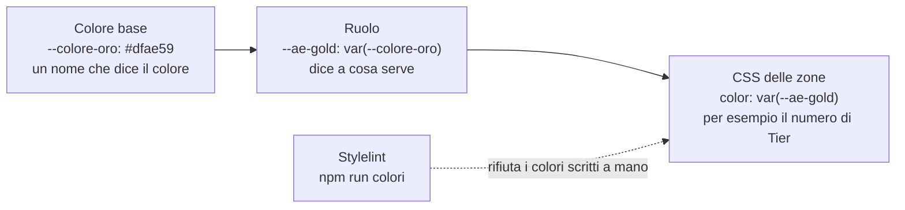
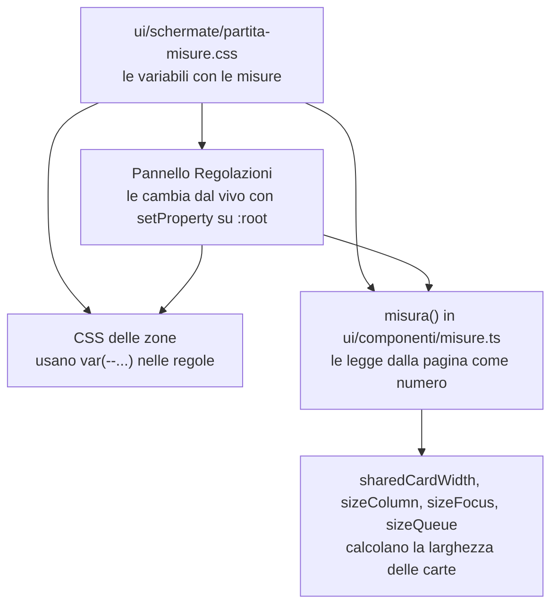
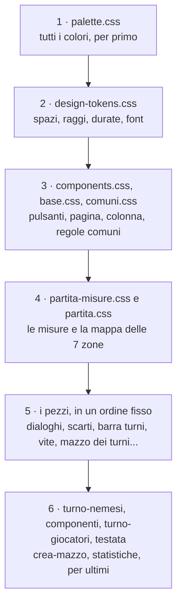
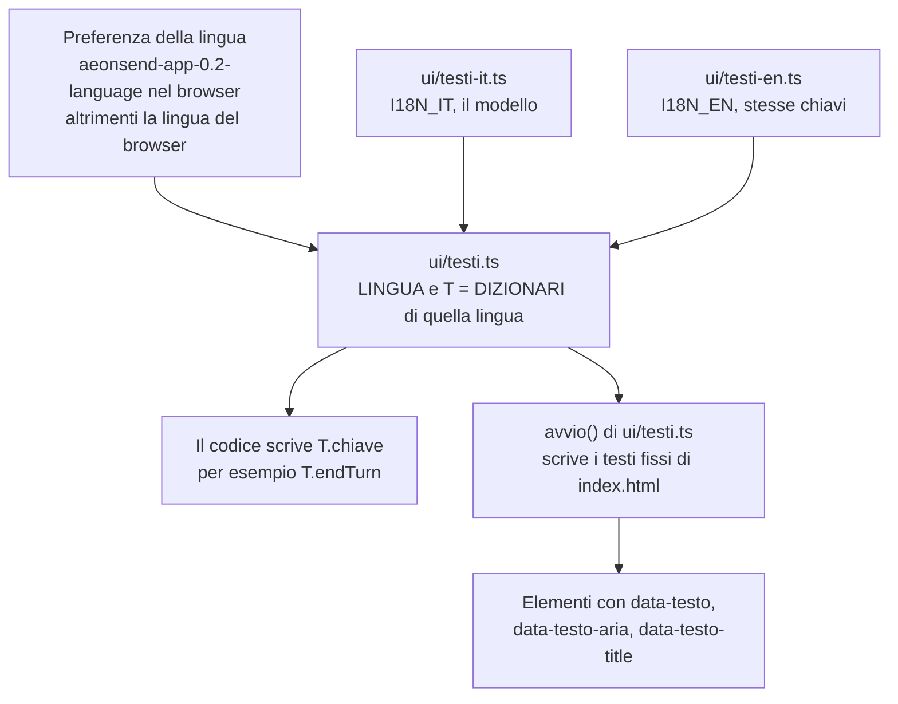

# 09 · L'aspetto: colori, misure, testi e lingue

**Cosa trovi qui.** Come è deciso l'aspetto dell'app: la palette dei colori a due strati, le misure delle zone (nel CSS e nel codice),
il pannello "Regolazioni" per provarle dal vivo, l'ordine in cui si caricano i CSS e come funzionano i testi nelle due lingue.

## Qualche parola da sapere

- **CSS.** I file `.css` dicono come si presenta ogni elemento della pagina: colore, spazi, dimensioni. L'HTML dice *cosa c'è*, il CSS
  dice *com'è fatto*.
- **Variabile CSS.** Un nome che vale un valore, scritto `--nome: valore;` e usato con `var(--nome)`. Cambiando il valore in un punto,
  cambia ovunque la variabile è usata. Per esempio `--colore-oro: #dfae59;` è "l'oro dell'app" in un solo posto.
- **Cascata.** Se due regole CSS dicono cose diverse sullo stesso elemento, vince di norma quella **scritta dopo**. L'ordine dei file CSS
  conta quindi quanto il loro contenuto.

## I colori: una palette a due strati

Tutti i colori dell'app stanno in un solo file, `stili/palette.css`. Fuori da lì **nessun CSS scrive un colore a mano**: lo controlla
Stylelint (`npm run colori`, lanciato anche da `npm run check`). I colori sono divisi in due strati.

Passo per passo:

1. **Colori base** (`--colore-*`). Hanno un **nome che dice il colore** (`--colore-oro`, `--colore-notte`, `--colore-perla`) e un valore
   (`#dfae59`). A destra un commento dice dove si usa ("Oro: colore di accento dell'app"). Sono raggruppati con commenti `/* --- titolo --- */`.
   Un colore base può avere una **trasparenza propria** (otto cifre, `#rrggbbaa`).
2. **Ruoli** (`--ae-*`, `--ombra`...). Hanno un **nome che dice a cosa serve il colore** (`--ae-gold`: accento; `--ae-text`: testo normale)
   e puntano a un colore base. I CSS usano **solo i ruoli**.
3. **Cambiare un colore**: si cambia il **valore del colore base** in `stili/palette.css`; cambia ovunque lo usano i ruoli che lo puntano.
4. **Aggiungere un ruolo**: prima, se manca, il colore base; poi il ruolo, con il commento "dove si vede". `tests/regolazioni.test.ts` controlla
   che ogni ruolo punti a un colore base che esiste.
5. **Le trasparenze** non si scrivono con `rgba(...)` ma con `color-mix(in srgb, var(--ruolo) 60%, transparent)`.
6. **Le eccezioni** (rare) hanno un commento che dice perché; senza motivo il controllo fallisce. I colori dentro le immagini SVG dei CSS
   non si vedono: sono due casi segnalati.

In `stili/design-tokens.css` ci sono, oltre ai colori, gli altri "ingredienti" riusabili: spazi, raggi degli angoli, durate delle animazioni
e i due font (Cinzel per i titoli, Inter per l'interfaccia, da Google Fonts: senza rete si usano i caratteri del sistema). Con la
preferenza "riduci movimento" del telefono le durate scendono a zero o quasi.

## Le misure: nel CSS e nel codice

Le misure delle sette zone ([file 06](06-schermata-partita.md)) sono tutte in **un file**: `ui/schermate/partita-misure.css`. Sono variabili
con un nome parlante e un commento (`--turno-barra-altezza: 8px; /* altezza della riga delle caselle */`), raggruppate per zona nello
stesso ordine della mappa. I due turni hanno le stesse misure: una variabile sola per cosa (le coppie `-giocatori` / `-nemesi` sono state unite).

Il diagramma mostra chi legge quelle variabili.

Passo per passo:

1. **Per cambiare una misura** si cambia il valore in `ui/schermate/partita-misure.css` e basta: il CSS e il codice usano tutti la stessa variabile.
2. **Nel codice non ci sono numeri di misura propri.** `misura('--carte-grandi-margine-lato')` legge la variabile dalla pagina (quando serve,
   perché al caricamento del modulo il CSS non c'è ancora). Se la variabile manca, l'app si ferma con un errore chiaro.
3. **Le carte grandi** hanno una larghezza calcolata (non fissa): `sharedCardWidth()` prende il minimo tra quanto starebbe per la larghezza
   e per l'altezza (zona 5 meno la riga vita/token e il suo spazio). La zona 6 dei comandi c'è sempre, vuota e invisibile (i comandi stanno sotto ogni carta, nel suo spazio), quindi non serve
   nessuna riserva: è **una sola regola per i due turni**, e una carta ha la stessa dimensione e posizione nel turno giocatori e nel turno nemesi.
   L'altezza che avanza si divide con i due pesi `--carte-grandi-avanzo-sopra` / `-sotto` (vedi [06](06-schermata-partita.md)). `sizeQueue()` e `sizeFocus()` la applicano alla coda e al carosello, e si rilanciano al ridimensionamento
   della finestra.
4. **Tablet e desktop** (da 768px di larghezza): la partita sta in una colonna al centro, calcolata da `sizeColumn()` (la carta più due
   pezzi delle vicine, mai meno di una larghezza minima).
5. Le misure dei due turni sono **le stesse**: spazio tra le carte grandi `--carte-grandi-spazio`, altezza e margine della fascia piccola
   `--carte-piccole-altezza` e `--carte-piccole-margine`. Anche la riga vita/token ha le sue (`--carte-grandi-goccia-numero`, `--carte-grandi-numero`,
   `--carte-piccole-goccia-numero`), e la carta da pescare/pescata la sua regola (`--carta-pescata-spazio-sopra`, `--carta-pescata-margine-lati`).
6. **Ogni variabile è una misura vera** (l'altezza di una cosa o lo spazio tra due cose con un nome): la prova `misure` dello strumento di confronto
   la aumenta di 10px e controlla che lo spazio misurato cresca di 10px. Una variabile nuova ha il suo caso in `tools/confronto/dati/misure.mjs`.

### Il pannello Regolazioni

Dalla **Modalità test** (menu iniziale, in fondo) si apre uno scenario di prova; durante lo scenario compare il pulsante **Regolazioni**.
Il pannello, in metà schermo e senza coprire la partita, ha due schede:

- **Colori**: i colori base di `stili/palette.css`, con un selettore (e un cursore per l'opacità se hanno trasparenza);
- **Misure**: le variabili di `ui/schermate/partita-misure.css`, per zona, con un campo numerico (non si regolano quelle con `calc()`).

Ogni cambio **si vede subito** (cambia la variabile su `:root`, e per le misure ridisegna). "Ripristina tutto" torna ai valori dei CSS;
"Copia" mette negli appunti **le sole variabili cambiate**, con il nome del file in cui vanno incollate. Le regolazioni valgono solo
nella Modalità test e si salvano a parte (`aeonsend-app-0.2-regolazioni`), mai nel salvataggio della partita. Per renderle definitive:
Copia, cambiare i valori nel file indicato, Ripristina tutto, poi `npm run check`, `npm test` e `npm run confronta` (vedi
[file 10](10-strumenti.md)). Etichette e gruppi del pannello si leggono dai commenti dei due CSS
(`ui/finestre/test-regolazioni-lettura.ts`, l'unico modulo che può leggere un CSS come testo).

## L'ordine dei CSS

Tutti i CSS si caricano da **un solo file**: `stili/indice.ts`, il primo import di `main.ts`. L'ordine delle sue righe **è** la cascata:
a parità di forza vince la regola scritta dopo, quindi qui l'ordine non è casuale.

Passo per passo:

1. Prima i **colori e i token** (le variabili): altrimenti il resto non troverebbe i valori.
2. Poi le regole di base di tutta l'app e le **misure e la mappa delle zone**, perché i pezzi dentro le zone le ritoccano.
3. Poi i **pezzi** (ogni `.css` sta accanto al `.ts` che crea i suoi elementi). Dove un file ritocca elementi di un altro **viene dopo di lui**:
   ogni file lo dice in testa ("Ordine: deve venire dopo ...").
4. **Una regola nuova** va nel file del suo pezzo. Se ritocca a parità di forza un elemento stilato da un file che viene dopo, o si alza la
   specificità (si rende la regola più "forte") o la regola va in quel file con il commento "Ordine: ...".
5. Se si sposta un `.css`, in `stili/indice.ts` cambia **solo il percorso**, mai la posizione. `check-moduli` rifiuta un `.css` importato altrove
   o non importato. Il controllo di aspetto dopo un cambiamento è `npm run confronta` ("schermate" deve restare identico).

## I testi e le lingue

L'app è in **italiano e inglese**. Nessun testo è scritto "a mano" nel codice: stanno in due **dizionari**, con le **stesse chiavi**,
e il codice chiede il testo per nome. Un controllo automatico (`check-moduli`) rifiuta testo italiano nei `.ts` fuori dai dizionari.

Passo per passo:

1. **I dizionari.** `ui/testi-it.ts` (`I18N_IT`) è il modello: una chiave per ogni testo, di solito una stringa (`endTurn: 'Fine turno'`)
   o una funzione quando serve un conto o un plurale (`players: (n) => ...`). `ui/testi-en.ts` ha le stesse chiavi: il tipo `Testi` lo impone,
   quindi una chiave mancante è un errore. I testi inglesi devono essere **brevi come quelli italiani**: i pulsanti stanno su una riga.
2. **`T`.** `ui/testi.ts` è l'unico accesso: sceglie **una volta sola, all'avvio**, il dizionario in base alla lingua (`LINGUA`) e lo chiama `T`.
   Il codice scrive `T.endTurn`; non esistono altri modi di avere un testo.
3. **La preferenza della lingua** (`stato/preferenze.ts`). Se l'utente l'ha scelta, è salvata nel browser (`aeonsend-app-0.2-language`); se no si
   usa la lingua del browser (inizia per "it" = italiano, tutto il resto = inglese). Si sceglie in **Opzioni → Lingua / Language**: cambiarla
   **salva e ricarica l'app**, perché i testi si scelgono all'avvio.
4. **I testi fissi di `index.html`** (quelli che esistono già nella pagina prima del codice) non sono scritti nel file: hanno un attributo che dice
   la chiave, `data-testo="playersTurn"` per il testo, `data-testo-aria` per l'etichetta dei lettori di schermo, `data-testo-title` per il
   suggerimento. `avvio()` di `ui/testi.ts` li scrive tutti (`applicaTestiFissi()`) e imposta anche `lang` della pagina.
5. **Restano fissi** (non cambiano con la lingua): il nome del gioco, il `manifest.webmanifest` (la descrizione è in italiano), la pagina
   `public/scheletri/` e le etichette del pannello Regolazioni.
6. **Una terza lingua** (per esempio il francese): il codice in `Lingua` e `LINGUE`, un nuovo file dei testi (come `ui/testi-en.ts`), la sua voce in `DIZIONARI` e in
   `check-moduli`, poi la prova `lingua` di `tools/confronto`. La procedura completa è in [src/ui/README.md](../src/ui/README.md).
7. **Per aggiungere un testo**: la chiave in `I18N_IT`, la stessa in `I18N_EN`, poi `T.chiave`. Lo strumento di confronto ha una prova `lingua` che
   apre l'app in italiano e inglese e segnala i testi che escono dal loro riquadro o che sono rimasti in italiano.

## Per approfondire

- Prima: [08 · Il mazzo dei turni](08-mazzo-dei-turni.md). Dopo: [10 · Gli strumenti](10-strumenti.md).
- Le zone e le misure: [06 · La schermata della partita](06-schermata-partita.md).
- [src/stili/README.md](../src/stili/README.md) (palette, ordine, Stylelint), [src/ui/README.md](../src/ui/README.md) (testi e lingue),
  [src/ui/finestre/README.md](../src/ui/finestre/README.md) (Modalità test e Regolazioni).
