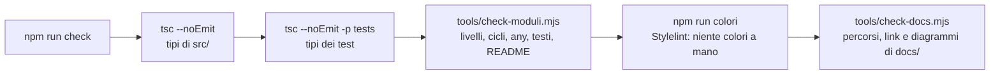
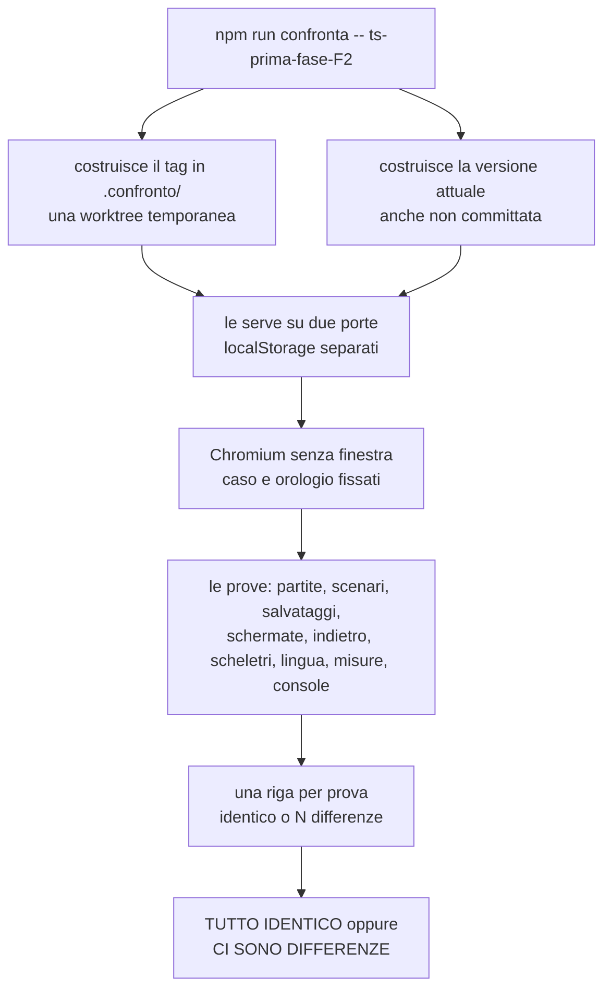
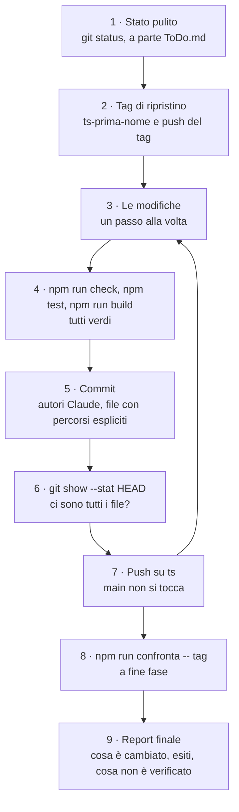

# 10 · Gli strumenti

**Cosa trovi qui.** I comandi per provare l'app, controllarla e confrontarla con una versione precedente: cosa fa ciascuno, quando usarlo,
a cosa servono i "tag di ripristino" e come si svolge, passo per passo, una fase di lavoro.

## Dove si lanciano

I comandi si scrivono in un **terminale** (in Windows, PowerShell) dalla cartella del repository. `npm` è il programma che li esegue: i nomi
come `npm run check` sono "scorciatoie" definite nel file `package.json`, alla voce `scripts`. La prima volta, in una cartella nuova, serve
`npm install` (o `npm ci`), che scarica le librerie di cui gli strumenti hanno bisogno in `node_modules/`.

## I comandi, uno per uno

| Comando | Cosa fa | Quando usarlo |
|---|---|---|
| `npm run dev` | avvia l'app in locale su `http://localhost:5173/AeonsEnd_App_0.2/`; ogni modifica ai file si vede da sola | mentre si lavora |
| `npm run build` | costruisce il sito finito in `dist/` ([file 01](01-il-progetto.md)) | prima di un commit, e per provare che la costruzione riesce |
| `npm run preview` | serve il contenuto di `dist/` su `http://localhost:4173/AeonsEnd_App_0.2/`, come sarà pubblicato | per provare il sito costruito, con il service worker vero |
| `npm run check` | tutti i controlli statici, vedi sotto | **prima di ogni commit** |
| `npm test` | i test automatici (Vitest) | **prima di ogni commit** |
| `npm run confronta -- <tag o commit>` | confronta la versione attuale con un'altra nel browser | a fine fase, dopo modifiche che non devono cambiare l'app |
| `npm run colori` | solo il controllo Stylelint dei colori | dopo aver toccato un CSS |
| `npm run docs` | solo il controllo di `docs/` | dopo aver toccato la documentazione |
| `node tools/check-moduli.mjs --conta` | quanti `any`, eccezioni ai tipi, file `.js` (attesi 0) | per una verifica rapida della pulizia |
| `python tools/import-db.py` | rigenera `cards.json`, `products.json` e le immagini dal DataBase | solo quando cambia il DataBase |

## `npm run check`: cosa controlla

`npm run check` esegue quattro controlli, uno dopo l'altro (il primo, `tsc`, viene lanciato due volte: su `src/` e su `tests/`);
**si ferma al primo che fallisce**.



Passo per passo:

1. **`tsc`** è il compilatore di TypeScript: legge `src/` (e poi `tests/`) e controlla che i **tipi** siano coerenti, cioè che ogni dato sia usato
   per quello che è (per esempio che a una funzione che vuole un numero non si passi un testo). `--noEmit` vuol dire "controlla soltanto,
   non produrre file".
2. **`tools/check-moduli.mjs`** controlla quello che `tsc` non vede: ogni nome importato esiste, nessuna variabile globale oltre a `window.app`,
   `regole/` pura, i CSS importati solo da `stili/indice.ts`, nessun `any`, la partita cambiata solo in `stato/partita.ts`, nessun testo
   italiano fuori dai dizionari, nessun ciclo di import, i **livelli** ([file 03](03-architettura.md)), nessun file sopra 500 righe, i blocchi
   fissi mostrati e nascosti solo da `ui/navigazione.ts`, e che **ogni file `.ts` di una cartella di `src/` sia citato nel `README.md` di quella
   cartella**.
3. **Stylelint** (`npm run colori`) rifiuta ogni colore scritto fuori da `stili/palette.css` ([file 09](09-aspetto.md)).
4. **`tools/check-docs.mjs`** controlla la documentazione (vedi sotto).

## `tools/check-docs.mjs`: perché la documentazione non invecchi

Una documentazione si rovina quando il codice cambia e lei no. Questo controllo ne cattura i segni più chiari. Per ogni file di `docs/`:

1. **I percorsi.** Ogni percorso di file scritto tra apici inversi (`stato/partita.ts`) deve esistere. Si cerca dalla radice del repository, poi in
   `src/` e in `public/`. Non contano i testi con spazi o segnaposto (`<nome>`), né le cartelle che esistono solo dopo un comando (`dist/`,
   `node_modules/`, `.confronto/`).
2. **I link.** Ogni link tra file (`[testo](altro.md)`) deve portare a un file che esiste.
3. **I diagrammi.** Ogni blocco ` ```mermaid ` si **disegna davvero**: lo script apre Chromium senza finestra con Playwright (lo stesso strumento
   usato dal confronto), carica la libreria `mermaid` e prova a disegnare ogni blocco. Un errore di scrittura in un diagramma fa fallire il controllo.

Il controllo **non** sa se un diagramma è *vero*: che dica ciò che il codice fa lo verifica chi scrive. Per questo la regola di lavoro è che chi
cambia la struttura (file, flussi, zone, campi dello stato) aggiorna anche `docs/`.

## `npm test`: i test automatici

I test (Vitest, cartella `tests/`) provano la **logica**: i mazzi nemesi per ogni nemesi, il mazzo dei turni, la risoluzione delle carte, le
vite, il salvataggio e i formati vecchi, `variantePartita()`, il tasto Indietro, i dizionari delle lingue. Non aprono un browser: importano
direttamente i moduli di `src/`, che al caricamento non fanno niente. Usano i **dati veri** di `public/` e un caso ripetibile (il "caso" è
`Math.random`, sostituito da una funzione che dà sempre la stessa sequenza). Quello che richiede un browser (disegno, animazioni, gesti) non si
prova qui ma con il confronto.

## `npm run confronta`: la stessa app, prima e dopo

Quando si cambia il codice senza voler cambiare l'app (per esempio riordinando file), serve una prova che **l'app sia davvero uguale**.
`npm run confronta -- <tag o commit>` costruisce la versione indicata e quella attuale, le apre una accanto all'altra in Chromium senza finestra, fa
le stesse operazioni nelle due e **confronta il risultato**, stato e aspetto compresi.



Passo per passo:

1. Si costruisce il riferimento (`<tag>`) in una **worktree** temporanea (una seconda copia di lavoro del repository, in `.confronto/`) e la
   versione attuale. La build del riferimento si riusa se il commit non cambia.
2. Le due versioni si servono su due porte (così i `localStorage` non si mischiano) e si aprono in un Chromium senza finestra.
3. **Caso e orologio sono finti e uguali** per le due: così le stesse azioni danno gli stessi risultati. Le animazioni vanno subito alla fine.
4. Le **prove**: `partite` (sette partite complete, con Undo e ripresa a metà), `scenari` (tutti quelli della Modalità test), `salvataggi` (salvataggi
   veri di versioni vecchie, ripresi e giocati), `schermate` (il giro di tutte le schermate a due misure: telefono e desktop, con lo stile
   calcolato di ogni elemento), `indietro` (il tasto Indietro), `scheletri` (la pagina `public/scheletri/`), `lingua` (l'app in italiano e inglese:
   cerca testi che escono dal loro riquadro), `misure` (non confronta due versioni: per ogni variabile di `src/ui/schermate/partita-misure.css` la aumenta di 10px e
   controlla che lo spazio tra le due cose del suo commento cresca di 10px, a tre formati di schermo e nei due turni) e `console` (errori dell'app, solo nella versione attuale).
5. L'esito è una riga per prova. Si legge con attenzione: **una differenza voluta** (un testo, un valore cambiato) si dichiara nel report;
   **le altre sono errori**. Tutti i dettagli sono in `.confronto/esito.json`. L'uscita è 0 se tutto è identico, 1 se ci sono differenze, 2 se lo
   strumento non riesce a lavorare. Un giro completo dura circa tre minuti.
6. Cosa il confronto **non** prova: animazioni vere, gesti con più dita, scorrimento inerziale, il telefono vero, le immagini come pixel, la rete
   lenta o assente e il service worker (è spento).

## I tag di ripristino

Un **tag** è un'etichetta fissa su un punto della storia del codice (un "segnalibro"). Prima di ogni fase o modifica grande si crea un tag
(`ts-prima-fase-F2`, per esempio) e lo si carica su GitHub: se qualcosa va storto si può tornare a quel punto. Per tornare a un tag non si
riscrive la storia: si ripubblica quello stato con un nuovo commit. L'elenco si vede con `git tag -l`; quelli principali sono in
`CONTESTO_SVILUPPO.md` (sezione 11). I tag servono anche al confronto: `npm run confronta -- <tag>` confronta con quel punto.

## Il flusso di lavoro di una fase

Una "fase" è un pezzo di lavoro compiuto, con un obiettivo. Il diagramma mostra i passi nell'ordine in cui si fanno.



Passo per passo:

1. **Stato pulito.** `git status` non deve mostrare modifiche impreviste. `ToDo.md` è dell'utente: si lascia com'è e **non entra mai nei commit**.
2. **Tag.** `git tag ts-prima-nome` e `git push origin ts-prima-nome`, così si può tornare indietro.
3. **Modifiche** a piccoli passi: ognuno finisce con un commit.
4. **Controlli.** `npm run check`, `npm test` e `npm run build` devono essere verdi **prima di ogni commit**.
5. **Commit.** Gli autori sono `Claude` e `noreply@anthropic.com`, passati con i flag del singolo comando (mai scritti nella configurazione).
   Si aggiungono solo i file toccati, con i percorsi scritti per esteso, mai `git add -A`.
6. **Verifica.** `git show --stat HEAD` elenca i file del commit: serve a notare un file nuovo dimenticato.
7. **Push** sul branch `ts`. `main` è il sito pubblicato e non si tocca finché `ts` non viene unito.
8. **Confronto** a fine fase: deve dire "TUTTO IDENTICO", salvo le differenze volute dichiarate.
9. **Report** in italiano semplice: cosa è cambiato, esito dei controlli e del confronto, cosa **non** è stato verificato (per esempio il telefono vero).

## Per approfondire

- Prima: [09 · L'aspetto](09-aspetto.md). Dopo: [11 · Glossario](11-glossario.md).
- La pubblicazione e il robot di GitHub: [01 · Il progetto](01-il-progetto.md) e [tools/README.md](../tools/README.md).
- Lo strumento di confronto nel dettaglio e come si aggiunge una prova: [tools/confronto/README.md](../tools/confronto/README.md).
- I test: [tests/README.md](../tests/README.md). Le regole di lavoro complete: [CONTESTO_SVILUPPO.md](../CONTESTO_SVILUPPO.md).
